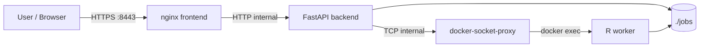

# MethylAnalyzer

MethylAnalyzer is a web-based DNA methylation analysis platform for Illumina IDAT data (EPICv2, EPICv1, 450K). The repository combines a React/TypeScript frontend served over HTTPS via nginx, a FastAPI backend, and an R-based processing engine for filtering, normalization, batch-effect correction, DMP/DMR analysis, result tables, exports, and heatmap generation.

The project is also known by the repository and team name BigTom.

## Table of Contents

- [Project Overview](#project-overview)
- [Purpose and Target Users](#purpose-and-target-users)
- [Main Features](#main-features)
- [Biological Analysis Workflow](#biological-analysis-workflow)
- [System Architecture](#system-architecture)
- [Repository Structure](#repository-structure)
- [Prerequisites](#prerequisites)
- [TLS Certificate Setup](#tls-certificate-setup)
- [Quick Start with Docker](#quick-start-with-docker)
- [Detailed Docker Setup and Operation](#detailed-docker-setup-and-operation)
- [Local Development Setup](#local-development-setup)
- [Configuration and Environment Variables](#configuration-and-environment-variables)
- [Application URLs and API Documentation](#application-urls-and-api-documentation)
- [Testing](#testing)
- [Deployment](#deployment)
- [Logging and Debugging](#logging-and-debugging)
- [Troubleshooting](#troubleshooting)
- [Job Data Retention and Cleanup](#job-data-retention-and-cleanup)
- [Security and Production Considerations](#security-and-production-considerations)
- [Additional Documentation](#additional-documentation)
- [Contributing and Development Workflow](#contributing-and-development-workflow)
- [License](#license)

## Project Overview

MethylAnalyzer lets users upload paired Green/Red IDAT files with a Sample Sheet, run a full methylation analysis pipeline, monitor job progress, and inspect generated outputs through the browser. The application is designed for containerized operation via Docker Compose and targets biologists without programming or R experience.

The stack runs fully within Docker and requires no local R or Python installation for end users. Operators provide biological input data and manage host storage; the application handles all analysis steps internally.

## Purpose and Target Users

This repository is intended for:

- Developers who need to run and extend the frontend, backend, or R analysis scripts.
- Operators who need to start the application with Docker Compose and inspect logs or job data.
- Maintainers and supervisors who need a central overview of architecture, workflow, configuration, testing, and limitations.

## Main Features

- Browser-based upload of `.idat` files and Sample Sheets (folder, ZIP, or individual files via drag-and-drop).
- Two-phase upload with a staging inspection step before the job is committed.
- Configurable quality filtering with live progress and filter statistics.
- Normalization preview: density plots (PNG/PDF) and an interactive PCA plotter (JSON-based, client-side rendering, PNG/PDF export).
- SVD-based batch-effect detection with an interactive heatmap visualization.
- Optional ComBat batch correction with round tracking; repeatable until the user is satisfied.
- Automated DMP and DMR analysis (limma and Bumphunter).
- Paginated, filterable, and sortable DMP/DMR result tables with CSV export.
- Heatmap generation (PNG/PDF) from the currently filtered table subset.
- HTTPS by default: TLS terminates at the nginx frontend container.
- Security-hardened Docker Compose setup: Docker Socket Proxy, read-only container filesystems, capability drops, resource limits.
- Automatic cleanup of expired job and staging directories.
- Playwright end-to-end test suite and a performance benchmark toolkit.

## Biological Analysis Workflow

The implemented pipeline follows this sequence:

```
UPLOAD -> FILTERING -> NORMALIZATION_PREVIEW -> NORMALIZATION -> SVD -> BATCH -> ANALYSIS -> RESULTS -> HEATMAP
```

1. Upload paired IDAT files and a Sample Sheet. Map Sample Sheet columns to canonical roles. Configure quality filters.
2. Execute quality filtering (`init_filter.R`); view filter statistics.
3. Generate normalization previews (`normalization_preview.R`): density plots and PCA data for five methods in parallel.
4. Select and confirm a normalization method (`normalize.R`).
5. Review the SVD plot for batch effects (`batch_svd.R`).
6. Optionally run ComBat batch correction (`batch_correct.R`); repeat until satisfied, then proceed.
7. Run DMP and DMR analysis automatically (`dmp.R`, `dmr.R`).
8. Inspect and filter DMP/DMR result tables; export as CSV.
9. Generate a heatmap from the filtered table (`heatmap.R`).
10. Reset the session: all server-side data is deleted immediately.

Important limitations:

- Job state is held in backend memory. Restarting the backend loses in-memory job status even if files still exist under `jobs/`.
- The `@slow` end-to-end tests require real IDAT data and take 10 to 20 minutes per run.



## System Architecture

Docker Compose defines four services connected by three isolated networks.

### Services

| Service | Purpose | Host ports |
|---|---|---|
| `frontend` | Builds the React SPA and serves it through nginx with TLS termination | 8080 (HTTP, redirects to HTTPS), 8443 (HTTPS) |
| `backend` | FastAPI REST API, job orchestration, resource governor, cleanup | 8000 |
| `r_worker` | R analysis engine: filtering, normalization, batch correction, DMP, DMR, heatmap | none |
| `docker-socket-proxy` | Security proxy that exposes only `CONTAINERS`, `EXEC`, and `POST` endpoints to the backend | none (internal) |

### Networks

| Network | Services | Notes |
|---|---|---|
| `frontend-net` | frontend, backend | Main bridge; accessible from the host |
| `proxy-net` | backend, docker-socket-proxy | Internal bridge; no external access |
| `isolated` | r_worker | Internal bridge; no internet access |

The backend connects to Docker through the socket proxy at `tcp://docker-socket-proxy:2375`. The raw Docker socket is not mounted in any application container.

### Container Mounts

| Container | Host path | Container path |
|---|---|---|
| frontend | `./certs/bigtom-local.pem` | `/etc/nginx/certs/bigtom-local.pem` (read-only) |
| frontend | `./certs/bigtom-local-key.pem` | `/etc/nginx/certs/bigtom-local-key.pem` (read-only) |
| backend | `./jobs` | `/app/jobs` |
| backend | `./r_backend` | `/app/r_backend` |
| r_worker | `./r_backend` | `/app/r_backend` |
| r_worker | `./data` | `/app/data` |
| r_worker | `./jobs` | `/app/jobs` |

Frontend and backend containers run with read-only root filesystems; writable areas are `tmpfs` mounts.

## Repository Structure

```text
.
├── backend/
│   ├── app/
│   │   ├── api/routes/
│   │   ├── core/
│   │   ├── models/
│   │   └── services/
│   ├── tests/
│   ├── Dockerfile
│   └── requirements.txt
├── benchmarks/
│   ├── run.sh          # per-step performance benchmark
│   ├── stress.sh       # concurrency stress test
│   ├── monitor.sh      # background cgroup sampler
│   └── summarize.awk   # report generator
├── certs/              # gitignored; TLS certificate files go here (see below)
├── data/               # mounted into r_worker as /app/data
├── docs/
│   ├── architecture/
│   ├── assets/
│   └── testing/
├── e2e/
│   ├── playwright.config.ts
│   └── tests/
├── frontend/
│   ├── app/
│   │   ├── src/
│   │   ├── package.json
│   │   └── vite.config.ts
│   └── Dockerfile
├── jobs/               # gitignored; bind-mounted job storage
├── nginx/
│   ├── nginx.conf
│   └── proxy_params
├── r_backend/
│   ├── utils/
│   ├── tests/
│   ├── Dockerfile
│   └── *.R
├── CHANGELOG.md
├── docker-compose.yml
├── .env.example
└── README.md
```

Key directories:

- `backend/`: FastAPI application, API routes, job services, resource governor, cleanup service, R executor, and pytest tests.
- `frontend/app/`: React, TypeScript, Vite, Vitest, and ESLint application source.
- `nginx/`: nginx reverse proxy configuration and proxy parameter file; copied into the frontend image during build.
- `r_backend/`: R analysis scripts, shared utility modules, R testthat tests, and the R worker Dockerfile.
- `e2e/`: Playwright end-to-end test suite against the running Docker Compose stack.
- `benchmarks/`: performance and stress-test scripts; see `benchmarks/README.md`.
- `data/`: mounted into the R worker; the repository does not include usable demo IDAT data.
- `jobs/`: bind-mounted job storage. Gitignored and may contain sensitive biological data.
- `certs/`: gitignored directory for TLS certificate files generated by mkcert.
- `docs/`: architecture documentation, testing strategy, and developer guides.

## Prerequisites

For Docker-based operation:

- Git
- Docker (Engine 24+ or Docker Desktop)
- Docker Compose v2
- [mkcert](https://github.com/FiloSottile/mkcert) for generating local TLS certificates

For local frontend development:

- Node.js 20 or later
- npm

For local backend development:

- Python 3.11
- pip

Docker is the recommended path for complete application execution.

## TLS Certificate Setup

The nginx container requires a TLS certificate before it can start. The required files are:

| File | Purpose |
|---|---|
| `certs/bigtom-local.pem` | Certificate (public) |
| `certs/bigtom-local-key.pem` | Private key |

These files are gitignored and must be generated once on each machine.

**Windows (PowerShell):**

See [docs/deployment/https-nginx.md](docs/deployment/https-nginx.md) for detailed certificate generation instructions on Windows.

**Linux and macOS:**

Install mkcert (for example via Homebrew or your package manager), then run:

```bash
mkdir -p certs
mkcert -install
mkcert -key-file certs/bigtom-local-key.pem -cert-file certs/bigtom-local.pem localhost 127.0.0.1 ::1
```

After generating the certificate, the browser needs to trust the mkcert root CA. The `mkcert -install` step handles this for the current user on most systems. If a browser still shows a certificate warning, restart the browser. See [docs/deployment/https-nginx.md](docs/deployment/https-nginx.md) for diagnostics.

Never commit `certs/` files or share `rootCA-key.pem`; that key can sign certificates trusted by any machine that installed the mkcert root.

## Quick Start with Docker

```bash
git clone <repository-url>
cd swtp-ss26-bigtom
cp .env.example .env
# Generate TLS certificates (see TLS Certificate Setup above)
docker compose up --build
```

Open:

- Application: `https://localhost:8443`
- HTTP redirects automatically to HTTPS: `http://localhost:8080`
- Backend Swagger UI (optional): `http://localhost:8000/docs`

The first R image build can take a long time because Bioconductor, ChAMP, and annotation packages are installed during the Docker build.

On Windows PowerShell, create the environment file with:

```powershell
Copy-Item .env.example .env
```

## Detailed Docker Setup and Operation

Build and start in the foreground:

```bash
docker compose up --build
```

Start in the background:

```bash
docker compose up -d --build
```

Check service status:

```bash
docker compose ps
```

View all logs:

```bash
docker compose logs -f
```

View service-specific logs:

```bash
docker compose logs -f backend
docker compose logs -f frontend
docker compose logs -f r_worker
```

Stop containers:

```bash
docker compose down
```

Rebuild after dependency or Dockerfile changes:

```bash
docker compose build backend
docker compose build frontend
docker compose build r_worker
docker compose up -d
```

Rebuild without cache when diagnosing image build issues:

```bash
docker compose build --no-cache r_worker
```

Use this carefully for the R image because it triggers a long full rebuild.

Remove containers and Docker-managed volumes:

```bash
docker compose down -v
```

Note: `docker compose down -v` removes Docker-managed volumes. Job files in `./jobs` are stored as host bind mounts and are not removed by `down -v`; they may be removed by the application cleanup service when expired.

Inspect running containers:

```bash
docker compose exec backend bash
docker compose exec frontend sh
docker compose exec r_worker bash
```

The `frontend` service is the nginx runtime image and does not contain Node.js or npm. Run frontend development commands locally from `frontend/app` or in a temporary Node container.

## Local Development Setup

### Frontend

```bash
cd frontend/app
npm ci
npm run dev
```

The Vite development server starts on `http://localhost:5173` by default. In Docker, the compiled frontend is served through nginx at `https://localhost:8443`.

Available npm scripts from `frontend/app/package.json`:

```bash
npm test
npm test -- --run
npm run lint
npm run build
npm run preview
```

Optional one-shot frontend tests in Docker:

```bash
docker run --rm \
  -v "$PWD/frontend/app:/app" \
  -v /app/node_modules \
  -w /app \
  node:20-alpine \
  sh -c "npm ci && npm test -- --run"
```

PowerShell:

```powershell
docker run --rm `
  -v "${PWD}/frontend/app:/app" `
  -v /app/node_modules `
  -w /app `
  node:20-alpine `
  sh -c "npm ci && npm test -- --run"
```

The anonymous `/app/node_modules` volume prevents Linux container dependencies from overwriting a host `frontend/app/node_modules` directory.

### Python/FastAPI Backend

PowerShell:

```powershell
cd backend
py -3.11 -m venv .venv
.\.venv\Scripts\Activate.ps1
pip install -r requirements.txt
$env:JOB_BASE_DIR = "..\jobs"
$env:JOB_RETENTION_HOURS = "24"
$env:JOB_CLEANUP_INTERVAL_SECONDS = "86400"
python -m uvicorn app.main:app --host 0.0.0.0 --port 8000 --reload
```

Linux and macOS:

```bash
cd backend
python3.11 -m venv .venv
source .venv/bin/activate
pip install -r requirements.txt
export JOB_BASE_DIR="../jobs"
export JOB_RETENTION_HOURS="24"
export JOB_CLEANUP_INTERVAL_SECONDS="86400"
python -m uvicorn app.main:app --host 0.0.0.0 --port 8000 --reload
```

Run backend tests:

```bash
cd backend
python -m pytest
```

Local backend limitation: R execution expects Docker access because the backend uses `docker exec` commands targeting the `r_worker` container. Keep the Docker `r_worker` service running for the complete workflow.

### R Worker

The R component is a collection of scripts, not an R package. The Docker image uses `rocker/r-ver:4.4.3` and installs Bioconductor, ChAMP, minfi, and related packages.

Start the R worker through Docker Compose:

```bash
docker compose up -d r_worker
```

Check R availability in the running service:

```bash
docker compose exec r_worker Rscript --version
```

Direct script execution is possible for debugging, but it bypasses FastAPI job-state handling:

```bash
JOB_ID="replace-with-real-job-id"
R_CONTAINER=$(docker compose ps -q r_worker)

docker exec "$R_CONTAINER" \
  Rscript /app/r_backend/normalize.R \
  "/app/jobs/$JOB_ID" \
  noob
```

Use direct R commands only on disposable test jobs or copied job directories.

## Configuration and Environment Variables

Copy `.env.example` to `.env` for Docker Compose:

```bash
cp .env.example .env
```

### Job Storage and Lifecycle

| Variable | Purpose | Default | Notes |
|---|---|---|---|
| `JOB_BASE_DIR` | Base directory for committed job files and R outputs | `/app/jobs` | Must match the bind mount in Docker Compose. |
| `JOB_RETENTION_HOURS` | Age threshold for automatic job directory cleanup | `24` | Must be a positive number. |
| `JOB_CLEANUP_INTERVAL_SECONDS` | Interval between cleanup scans for committed jobs | `86400` | Must be a positive integer. |
| `STAGING_BASE_DIR` | Directory for uncommitted staging uploads | `/app/staging` | Separate lifecycle from committed jobs. |
| `STAGING_RETENTION_HOURS` | Maximum age of uncommitted staging uploads | `2` | Staging directories are checked every `STAGING_CLEANUP_INTERVAL_SECONDS`. |
| `STAGING_CLEANUP_INTERVAL_SECONDS` | Interval between staging cleanup scans | `900` | |

### Container Resource Limits (Hard Walls)

| Variable | Purpose | Default | Notes |
|---|---|---|---|
| `R_WORKER_MEM_LIMIT` | Docker memory limit for the r_worker container | `10g` | If the container exceeds this, its cgroup OOM-killer stops the R process; the host stays alive. Tune to available RAM. |
| `R_WORKER_CPUS` | Docker CPU limit for the r_worker container | `2` | |
| `BACKEND_MEM_LIMIT` | Docker memory limit for the backend container | `1g` | The backend only orchestrates and needs little RAM. |

### Resource Governor (Soft Admission Control)

| Variable | Purpose | Default | Notes |
|---|---|---|---|
| `PIPELINE_MEMORY_BUDGET_GB` | Soft memory budget: jobs exceeding this are queued | `8` | Must be at most `R_WORKER_MEM_LIMIT`. |
| `PIPELINE_CORE_BUDGET` | Soft CPU core budget | `2` | |

### Per-Step Memory Estimates (Used by the Soft Queue)

| Variable | Purpose | Default | Notes |
|---|---|---|---|
| `PIPELINE_STEP_MEMORY_GB` | Memory estimate for standard pipeline steps | `5` | Based on benchmark results in `benchmarks/`. |
| `PIPELINE_DMR_MEMORY_GB` | Memory estimate for the DMR step | `6` | Each DMR core holds a copy of the beta matrix; re-measure when data changes. |
| `PIPELINE_DMP_MEMORY_GB` | Memory estimate for the DMP step | `4` | |
| `DMR_CORES` | Bootstrap cores for `dmr.R` | `1` | Raising this multiplies DMR RAM linearly. Raise `PIPELINE_DMR_MEMORY_GB` accordingly. |

### Intake Guards

| Variable | Purpose | Default | Notes |
|---|---|---|---|
| `MAX_SAMPLES_PER_JOB` | Hard upper limit on IDAT pairs per upload | `48` | Uploads exceeding this are rejected immediately with a clear message. |
| `MAX_JOBS_DISK_GB` | Maximum total disk space for all job directories combined | `0` (disabled) | Set to a value appropriate for the deployment disk size. |
| `MAX_TOTAL_UPLOAD_MB` | Maximum total IDAT file size per upload | `900` | nginx client body limit is 1400 MB, providing a buffer. |
| `MAX_SAMPLE_SHEET_MB` | Maximum sample sheet file size | `10` | |

### API and Logging

| Variable | Purpose | Default | Notes |
|---|---|---|---|
| `CORS_ALLOWED_ORIGINS` | Comma-separated list of browser origins allowed to call the API | `http://localhost:3000,...` | Set to the deployed frontend origin in production, for example `https://app.example.com`. |
| `LOG_LEVEL` | Python logging level for the backend | `DEBUG` | Use `INFO` or higher in production. |

### R Worker Threading

| Variable | Purpose | Default |
|---|---|---|
| `OMP_NUM_THREADS` | Limits OpenMP threads | `1` |
| `OPENBLAS_NUM_THREADS` | Limits OpenBLAS threads | `1` |
| `MKL_NUM_THREADS` | Limits MKL threads | `1` |
| `BLAS_NUM_THREADS` | Limits BLAS threads | `1` |
| `BIOCPARALLEL_WORKER_NUMBER` | Limits Bioconductor parallel workers | `1` |
| `R_BIOC_PARALLEL_WORKERS` | Limits R/Bioconductor parallel workers | `1` |

All threading variables are set to `1` to prevent uncontrolled thread proliferation and ensure the container resource limits are the actual ceiling.

### Sizing Examples

The `.env.example` file contains commented sizing examples for a development laptop (16 GiB) and a dedicated server (20 GiB, shared with other apps). The golden rule: `R_WORKER_MEM_LIMIT + BACKEND_MEM_LIMIT + (other apps) + OS headroom` must be at or below the machine's physical RAM.

## Application URLs and API Documentation

| Target | URL |
|---|---|
| Application (HTTPS) | `https://localhost:8443` |
| Application (HTTP redirect) | `http://localhost:8080` |
| Backend root | `http://localhost:8000/` |
| Swagger UI | `http://localhost:8000/docs` |
| OpenAPI JSON | `http://localhost:8000/openapi.json` |

Frontend routes implemented in `frontend/app/src/App.tsx`:

- `/`
- `/upload`
- `/analysis/:job_id`
- `/normalization/:job_id`
- `/batch/:job_id`
- `/results/:job_id`
- `/privacy`

Main API endpoints implemented by FastAPI:

The Swagger UI at `/docs` is the authoritative API reference for a running backend. The table below lists the primary routes from the current FastAPI routers.

| Method | Path | Purpose |
|---|---|---|
| `GET` | `/` | Backend root message and API version. |
| `POST` | `/api/v1/upload` | Upload IDAT files, Sample Sheet, and filter settings. |
| `GET` | `/api/v1/status/{job_id}` | Read in-memory job status. |
| `GET` | `/api/v1/filter/{job_id}/stats` | Read filtering statistics after filtering has completed. |
| `GET` | `/api/v1/preview/normalization/{job_id}` | Read normalization preview metadata. |
| `GET` | `/api/v1/preview/normalization/{job_id}/{plot_name}` | Download a normalization preview PNG or PDF. |
| `POST` | `/api/v1/normalize/{job_id}` | Start normalization. |
| `POST` | `/api/v1/reset/{job_id}` | Cancel and permanently delete a job and all its data. |
| `GET` | `/api/v1/batch/{job_id}/batch-options` | Read eligible Sample Sheet columns for batch correction. |
| `GET` | `/api/v1/batch/{job_id}/history` | Read batch correction history. |
| `POST` | `/api/v1/batch/{job_id}` | Start batch correction. |
| `POST` | `/api/v1/batch/{job_id}/skip` | Skip batch correction and start downstream analysis. |
| `GET` | `/api/v1/batch/{job_id}/svd-plot/{round_id}` | Download an SVD plot PNG or PDF. |
| `GET` | `/api/v1/table/{job_id}/{table}` | Read paginated `dmp` or `dmr` results with filtering and sorting. |
| `GET` | `/api/v1/table/{job_id}/{table}/export` | Export `dmp` or `dmr` results as CSV. |
| `GET` | `/api/v1/heatmap/{job_id}/options` | Read eligible Sample Sheet columns for heatmap sorting. |
| `POST` | `/api/v1/heatmap/{job_id}` | Start heatmap generation. |
| `GET` | `/api/v1/heatmap/{job_id}` | Download `heatmap.png` or `heatmap.pdf`. |

## Testing

The repository contains backend pytest tests, frontend Vitest tests, R testthat test files, and a Playwright end-to-end suite.

Docker service validation:

```bash
docker compose config --services
docker compose ps
```

### Backend Tests

```bash
docker compose exec backend pytest
```

Or locally:

```bash
cd backend
python -m pytest
```

### Frontend Tests

```bash
cd frontend/app
npm ci
npm test -- --run
npm run lint
npm run build
```

### R Tests

R test files exist under `r_backend/tests/` and use testthat. The current `r_backend/Dockerfile` does not install testthat, so R tests require a temporary or permanent addition of the package to the image.

Temporary installation (lost when the container is removed or rebuilt):

```bash
docker compose exec r_worker Rscript -e \
  "install.packages('testthat', repos='https://cloud.r-project.org')"
```

Run the R tests after installation:

```bash
docker compose exec r_worker Rscript \
  -e "setwd('/app/r_backend'); testthat::test_dir('tests')"
```

### End-to-End Tests (Playwright)

The E2E suite runs against the full running Docker Compose stack (`https://localhost:8443`). The stack must be up before running tests. See `e2e/README.md` for full details.

Prerequisites: the Docker Compose stack must be running (`docker compose up -d`).

**Fast suite** (seconds, no IDAT data required):

```bash
# With Node.js installed locally
cd e2e
npm ci
npx playwright install chromium
npm run test:fast
```

```bash
# With Docker, Linux (--network host reaches localhost:8443)
docker run --rm \
  --network host \
  -v "$PWD/e2e:/e2e" \
  -w /e2e \
  mcr.microsoft.com/playwright:v1.61.0-noble \
  sh -c "npm ci && npx playwright install chromium && npm run test:fast"
```

```powershell
# With Docker, Windows/macOS (host.docker.internal for host access)
docker run --rm `
  -e E2E_BASE_URL=https://host.docker.internal:8443 `
  -v "${PWD}/e2e:/e2e" `
  -w /e2e `
  mcr.microsoft.com/playwright:v1.61.0-noble `
  sh -c "npm ci && npx playwright install chromium && npm run test:fast"
```

**Full suite** (10 to 20 minutes, requires a real IDAT dataset):

```bash
export E2E_DATASET_DIR=/absolute/path/to/idat_dataset
docker run --rm \
  --network host \
  -e E2E_DATASET_DIR=/dataset \
  -v "$PWD/e2e:/e2e" \
  -v "$E2E_DATASET_DIR:/dataset:ro" \
  -w /e2e \
  mcr.microsoft.com/playwright:v1.61.0-noble \
  sh -c "npm ci && npx playwright install chromium && npm test"
```

If no dataset is found, upload-based `@slow` tests skip gracefully instead of failing.

### Manual API Smoke Checks

```bash
curl -k -i https://localhost:8443/
curl -i http://localhost:8000/docs
```

## Deployment

The repository provides a Docker Compose-based deployment workflow. Automated CI/CD pipelines, Kubernetes manifests, database-backed job persistence, and backup automation are not included.

For a Compose-based deployment:

1. Prepare the host with Docker and Docker Compose.
2. Create `.env` from `.env.example` and adjust limits to match available hardware (see sizing examples in `.env.example`).
3. Obtain or generate TLS certificates (see TLS Certificate Setup above). For production, use certificates from a trusted CA instead of mkcert.
4. Build images:

   ```bash
   docker compose build
   ```

5. Start services in detached mode:

   ```bash
   docker compose up -d
   ```

6. Verify services:

   ```bash
   docker compose ps
   docker compose logs -f
   ```

Deployment considerations:

- The frontend binds to host ports 8080 (HTTP redirect) and 8443 (HTTPS). Adjust the host port mappings in `docker-compose.yml` for standard ports 80 and 443 on production servers.
- TLS is handled by the nginx container. For production, replace the mkcert certificate with one from a trusted CA or use an external reverse proxy that handles TLS.
- `./jobs` is bind-mounted host storage and may contain sensitive biological data.
- Job directories are automatically deleted after `JOB_RETENTION_HOURS` based on modification time.
- Staging directories for uncommitted uploads are cleaned up separately every `STAGING_CLEANUP_INTERVAL_SECONDS`.
- Backend job state is not durable across backend restarts.
- Application updates require pulling the repository, rebuilding images, and restarting Compose services.
- Set `CORS_ALLOWED_ORIGINS` in `.env` to the actual deployed frontend origin before exposing the backend port publicly.

## Logging and Debugging

General logs:

```bash
docker compose logs -f
```

Service logs:

```bash
docker compose logs -f backend
docker compose logs -f frontend
docker compose logs -f r_worker
```

Recent logs:

```bash
docker compose logs --tail=100 backend
docker compose logs --tail=100 r_worker
```

Container status:

```bash
docker compose ps
docker ps
```

Useful debugging points:

- Browser developer console: frontend runtime errors.
- Browser Network tab: failed API requests and response bodies.
- FastAPI Swagger UI at `/docs`: API shape and manual route checks.
- `GET /api/v1/status/{job_id}`: current in-memory job status.
- `GET /api/v1/filter/{job_id}/stats`: filtering output after filtering has completed.
- `./jobs/{job_id}/`: uploaded files and generated R outputs on the host.
- Backend logs: upload validation, job state transitions, resource governor decisions, cleanup service, and R executor output.
- R worker logs: package loading, R script progress messages, and R errors.
- `docker compose config`: effective Compose configuration after `.env` substitution.

HTTPS-specific diagnostics (Windows):

​```powershell
docker compose exec frontend nginx -t
​```

See [docs/deployment/https-nginx.md](docs/deployment/https-nginx.md) for further diagnostics.

## Troubleshooting

| Problem | Possible cause | Recommended action |
|---|---|---|
| Port 8080 or 8443 is already in use | Another local process or old container is using the port | Stop the conflicting process or run `docker compose down`. |
| Browser shows certificate warning | mkcert root CA is not installed in the browser or OS trust store | Run `mkcert -install`, then restart the browser. See [docs/deployment/https-nginx.md](docs/deployment/https-nginx.md) for Windows instructions. |
| Frontend cannot reach backend | Backend is not running or nginx proxy cannot reach `backend:8000` | Check `docker compose ps`, `docker compose logs -f backend`, and browser Network requests. |
| Backend route returns 404 for a job that has files in `jobs/` | Job metadata is stored in memory and was lost after backend restart | Re-run the upload workflow or start a new session. |
| Upload returns 400 for IDAT files | Missing files, non-`.idat` extension, binary format check failed, odd number of IDAT files, duplicate filenames, or total size above the backend limit | Upload paired Green/Red `.idat` files with unique filenames and valid binary content. |
| Upload returns 415 for Sample Sheet | Unsupported extension or invalid file content | Use a valid `.csv`, `.xlsx`, or `.xls` file. |
| Upload is rejected because of size | Backend IDAT total limit is 900 MB; Sample Sheet limit is 10 MB; nginx request limit is 1400 MB | Reduce upload size or adjust limits in `.env`. |
| Filtering statistics are not available | Filtering is still running or failed before `filter_stats.json` was written | Poll `/api/v1/status/{job_id}` and inspect backend and R worker logs. |
| Normalization preview is not available | Preview generation is still running, failed, or no preview files were generated | Check job status and inspect `./jobs/{job_id}/`. |
| Normalization fails | Missing `filtered_data.rds`, invalid method for the R script, or R dependency problem | Confirm filtering completed and inspect `docker compose logs -f r_worker`. |
| R image build takes a long time | Bioconductor, ChAMP, ChAMPdata, and annotation packages are installed during the Docker build | Let the build finish; rebuild only the affected image when possible. |
| R package missing at runtime | Stale or failed image build, or package is not declared in the Dockerfile | Rebuild `r_worker` for declared packages. For undeclared `testthat`, install it temporarily as described in the Testing section. |
| Frontend npm command fails inside the `frontend` service | The running service is nginx and does not include Node.js or npm | Run npm commands from `frontend/app` locally or in a temporary Node container. |
| PowerShell blocks virtual environment activation | Execution policy prevents scripts | Set an approved execution policy for the current user or activate through another supported shell. |
| Job files disappear | Automatic cleanup removed directories older than `JOB_RETENTION_HOURS` | Increase retention before starting the backend if longer retention is needed. |
| `docker-socket-proxy` fails to start | Docker socket is not accessible on the host | Ensure Docker is running and the current user has access to the Docker daemon. |

## Job Data Retention and Cleanup

The backend runs two asynchronous cleanup loops during startup.

**Committed jobs** under `JOB_BASE_DIR` are deleted when their modification time is older than `JOB_RETENTION_HOURS`. The cleanup scan runs every `JOB_CLEANUP_INTERVAL_SECONDS` (default: once per day).

**Staging directories** for uncommitted uploads are deleted when older than `STAGING_RETENTION_HOURS` (default: 2 hours). The scan runs every `STAGING_CLEANUP_INTERVAL_SECONDS` (default: every 15 minutes).

Defaults from `.env.example`:

| Variable | Default |
|---|---|
| `JOB_BASE_DIR` | `/app/jobs` |
| `JOB_RETENTION_HOURS` | `24` |
| `JOB_CLEANUP_INTERVAL_SECONDS` | `86400` |
| `STAGING_BASE_DIR` | `/app/staging` |
| `STAGING_RETENTION_HOURS` | `2` |
| `STAGING_CLEANUP_INTERVAL_SECONDS` | `900` |

Operational notes:

- Job files can contain sensitive biological data and must not be committed to the repository.
- `.gitignore` excludes `jobs/`, `certs/`, real IDAT files, local environments, generated frontend builds, and common secret file extensions.
- The cleanup service does not replace a backup or retention policy for production data.

## Security and Production Considerations

- Do not commit private IDAT files, Sample Sheets, `.env` files, TLS keys, certificates, or generated job data.
- Treat `./jobs` and `./certs` as sensitive storage.
- The backend connects to Docker through the `docker-socket-proxy` container, which limits the exposed Docker API to `CONTAINERS`, `EXEC`, and `POST` only. The raw Docker socket (`/var/run/docker.sock`) is not mounted in any application container.
- All containers run with `cap_drop: ALL` and `no-new-privileges: true`. Frontend and backend containers use read-only root filesystems.
- The r_worker container is on an isolated Docker network without internet access.
- The application does not include authentication or authorization. All users share the same session space on a running instance.
- For production deployments: replace the mkcert development certificate with one from a trusted CA. Set `CORS_ALLOWED_ORIGINS` to the actual frontend origin. Review upload limits, retention settings, and resource limits. Consider placing an authenticated reverse proxy in front of the application.
- Review upload limits, retention settings, and resource limits before a production deployment.

## Additional Documentation

- [CHANGELOG.md](CHANGELOG.md): project change history.
- [docs/architecture/README.md](docs/architecture/README.md): entry point for architecture documentation, including the job lifecycle and state machine.
- [docs/backend/README.md](docs/backend/README.md): entry point for backend-related documentation.
- [docs/contracts/README.md](docs/contracts/README.md): entry point for contracts and data specifications.
- [docs/deployment/README.md](docs/deployment/README.md): entry point for deployment and operations documentation.
- [docs/frontend/README.md](docs/frontend/README.md): entry point for frontend documentation.
- [docs/testing/testing-strategy.md](docs/testing/testing-strategy.md): detailed testing strategy including how to run each test type.
- [benchmarks/README.md](benchmarks/README.md): performance and stress-test toolkit documentation.
- [e2e/README.md](e2e/README.md): end-to-end test suite documentation with full Docker run commands.
- FastAPI Swagger UI is available at `http://localhost:8000/docs` from a running backend.

## Contributing and Development Workflow

No formal contribution guide is included in the repository. Use the existing project structure and tests when making changes:

- Keep frontend changes in `frontend/app`.
- Keep backend API, service, and model changes in `backend/app`.
- Keep nginx configuration changes in `nginx/`.
- Keep R analysis changes in `r_backend`.
- Run the relevant backend, frontend, and R checks before handing off work.
- Do not commit generated job data, private biological data, local virtual environments, dependency folders, or certificate files.

## License

No license file is present in the repository. Do not assume redistribution or usage terms without clarification from the project owners.
