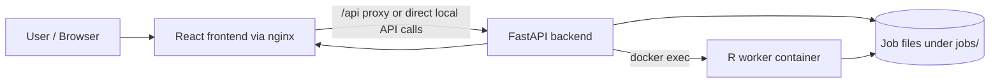

# MethylAnalyzer

MethylAnalyzer is a web-based DNA methylation analysis platform for Illumina IDAT data. The repository combines a React/TypeScript frontend, a FastAPI backend, and an R-based processing component for filtering, normalization, batch-effect handling, downstream analysis, result tables, exports, and heatmap generation.

The project is also known by the repository/team name BigTom. The application name used in this README is MethylAnalyzer.

## Table of Contents

- [Project Overview](#project-overview)
- [Purpose and Target Users](#purpose-and-target-users)
- [Main Features](#main-features)
- [Biological Analysis Workflow](#biological-analysis-workflow)
- [System Architecture](#system-architecture)
- [Repository Structure](#repository-structure)
- [Prerequisites](#prerequisites)
- [Quick Start with Docker](#quick-start-with-docker)
- [Detailed Docker Setup and Operation](#detailed-docker-setup-and-operation)
- [Local Development Setup](#local-development-setup)
- [Configuration and Environment Variables](#configuration-and-environment-variables)
- [Application URLs and API Documentation](#application-urls-and-api-documentation)
- [Testing](#testing)
- [Deployment](#deployment)
- [Logging and Debugging](#logging-and-debugging)
- [Troubleshooting](#troubleshooting)
- [Job Data Retention and Cleanup](#job-data-retention-and-cleanup)
- [Security and Production Considerations](#security-and-production-considerations)
- [Additional Documentation](#additional-documentation)
- [Contributing and Development Workflow](#contributing-and-development-workflow)
- [License](#license)

## Project Overview

MethylAnalyzer lets users upload paired Green/Red IDAT files with a compatible Sample Sheet, run methylation analysis steps, monitor job progress, and inspect generated outputs through the browser. It is designed for local Docker Compose operation and for Compose-based deployments where operators provide the required biological input data and manage host storage.

The current implementation is under active development. The README documents functionality that exists in this repository; it does not describe a hardened production platform, a durable database-backed job system, or an automated CI/CD deployment pipeline.

## Purpose and Target Users

This repository is intended for:

- Developers who need to run and extend the frontend, backend, or R analysis scripts.
- Operators who need to start the application with Docker Compose and inspect logs or job data.
- Maintainers and supervisors who need a central overview of architecture, workflow, configuration, testing, and limitations.

## Main Features

- Browser-based upload of `.idat` files and Sample Sheets.
- Backend validation for IDAT file extension, basic binary plausibility, file count pairing, duplicate filenames, Sample Sheet format, and upload size limits.
- Configurable filtering settings submitted as part of the upload request.
- Background R execution for filtering and normalization preview generation.
- Job status polling through the FastAPI backend.
- Filtering statistics endpoint after filtering has completed.
- Normalization preview metadata and preview PNG delivery.
- Normalization selection with supported API methods `noob`, `quantile`, `swan`, `funnorm`, and `raw`.
- Batch correction endpoints, SVD plot retrieval, batch history, and skip-to-downstream workflow.
- DMP/DMR result table endpoints with pagination, sorting, filtering, and CSV export.
- Heatmap options, heatmap generation, and heatmap PNG retrieval.
- Automatic cleanup of expired job directories.

## Biological Analysis Workflow

The implemented workflow is:

1. Upload paired Green/Red IDAT files and a Sample Sheet through the frontend or `POST /api/v1/upload`.
2. Validate uploaded data in the backend.
3. Store uploaded job files under the configured job directory.
4. Run `init_filter.R` in the R worker to perform quality filtering and write filtering outputs such as `filtered_data.rds` and `filter_stats.json`.
5. Generate normalization preview plots through `normalization_preview.R`.
6. Poll job status and retrieve filtering statistics and normalization preview metadata.
7. Start normalization with `POST /api/v1/normalize/{job_id}`.
8. Generate an initial SVD plot after normalization.
9. Run batch correction or skip it and continue to downstream analysis.
10. Run DMR and DMP analysis scripts as part of the downstream workflow.
11. Display and export DMP/DMR result tables.
12. Generate and retrieve heatmaps from DMP output.
13. Remove expired job directories through the backend cleanup service.

Important limitations:

- Job state is stored in backend memory. Restarting the backend loses in-memory job status even if files still exist in `jobs/`.
- The backend R executor uses Docker commands to run scripts in the `r_worker` container.
- Some frontend batch/SVD code still references `http://localhost:8000`, which matters for non-local deployments.
- Integration workflows require valid biological test data and prepared job state; they are not guaranteed to run from an empty checkout.

Aktuell ist der Upload ausschließlich über **https://localhost:3000/upload** verfügbar.



Docker Compose defines three services:

| Service | Purpose | Host port | Container port |
| --- | --- | --- | --- |
| `frontend` | Builds the React app and serves it through nginx | `3000` | `80` |
| `backend` | FastAPI API and background job orchestration | `8000` | `8000` |
| `r_worker` | R runtime and analysis scripts | none | none |

The backend mounts:

- `./jobs:/app/jobs`
- `./r_backend:/app/r_backend`
- `/var/run/docker.sock:/var/run/docker.sock`

The R worker mounts:

- `./r_backend:/app/r_backend`
- `./data:/app/data`
- `./jobs:/app/jobs`

## Repository Structure

```text
.
├── backend/
│   ├── app/
│   │   ├── api/routes/
│   │   ├── core/
│   │   ├── models/
│   │   └── services/
│   ├── tests/
│   ├── Dockerfile
│   └── requirements.txt
├── frontend/
│   ├── app/
│   │   ├── src/
│   │   ├── package.json
│   │   └── vite.config.ts
│   ├── Dockerfile
│   └── nginx.conf
├── r_backend/
│   ├── tests/
│   ├── utils/
│   ├── Dockerfile
│   └── *.R
├── data/
├── jobs/
├── CHANGELOG.md
├── docker-compose.yml
├── .env.example
└── README.md
```

Key directories:

- `backend/`: FastAPI application, API routes, job services, cleanup service, R executor, and Pytest tests.
- `frontend/app/`: React, TypeScript, Vite, Vitest, and ESLint application source.
- `frontend/`: frontend Dockerfile and nginx reverse proxy configuration.
- `r_backend/`: R scripts, R tests, Dockerfile, and progress helpers.
- `data/`: mounted into the R worker as `/app/data`; the inspected checkout does not include usable demo IDAT data.
- `jobs/`: bind-mounted job storage. It is ignored by Git and may contain sensitive biological data.

## Prerequisites

For Docker-based operation:

- Git
- Docker
- Docker Compose v2

For local frontend development:

- Node.js compatible with the `node:20-alpine` Docker build stage
- npm

For local backend development:

- Python 3.11, matching `backend/Dockerfile`
- pip

For local R script work:

- R 4.4.x, matching the `rocker/r-ver:4.4.3` R image
- Bioconductor packages used by the R scripts

Docker is the recommended path for complete application execution because the backend currently invokes R scripts through Docker.

## Quick Start with Docker

```bash
git clone git@magrathea.mni.thm.de:swtp-ss26-bigtom.git 
cd swtp-ss26-bigtom
cp .env.example .env
docker compose up --build
```
Hinweise: The SSH clone command requires an SSH key registered with the project Git server.

Open:

- Application: <http://localhost:3000>
- Upload page: <http://localhost:3000/upload>
- FastAPI documentation: <http://localhost:8000/docs>
- OpenAPI JSON: <http://localhost:8000/openapi.json>

On Windows PowerShell, create the environment file with:

```powershell
Copy-Item .env.example .env
```

The first R image build can take a long time because Bioconductor, ChAMP, and annotation packages are installed during the Docker build.

## Detailed Docker Setup and Operation

Build and start in the foreground:

```bash
docker compose up --build
```

Start in the background:

```bash
docker compose up -d --build
```

Check service status:

```bash
docker compose ps
```

View all logs:

```bash
docker compose logs -f
```

View service-specific logs:

```bash
docker compose logs -f backend
docker compose logs -f frontend
docker compose logs -f r_worker
```

Stop containers:

```bash
docker compose down
```

Rebuild after dependency or Dockerfile changes:

```bash
docker compose build backend
docker compose build frontend
docker compose build r_worker
docker compose up -d
```

Rebuild without cache when diagnosing image build issues:

```bash
docker compose build --no-cache r_worker
```

Use this carefully for the R image because it can trigger a long full rebuild.

Remove containers and Docker-managed volumes:

```bash
docker compose down -v
```

Warning: `docker compose down -v` removes Docker-managed volumes. This repository also stores job files in the host bind mount `./jobs`; those files are not removed by `down -v`, but they may be removed by the application cleanup service when expired.

Inspect containers:

```bash
docker compose exec backend bash
docker compose exec frontend sh
docker compose exec r_worker bash
```

The `frontend` service is the nginx runtime image and does not contain Node.js or npm. Run frontend development commands locally from `frontend/app` or in a separate temporary Node container.

## Local Development Setup

### Frontend

```bash
cd frontend/app
npm ci
npm run dev
```

The Vite development server starts on its default local development port unless another port is selected by Vite. In Docker, the compiled frontend is served through nginx at <http://localhost:3000>.

Available npm scripts from `frontend/app/package.json`:

```bash
npm test
npm test -- --run
npm run lint
npm run build
npm run preview
```

The production Docker build uses `node:20-alpine`, runs `npm install`, and then runs `npm run build`. The nginx runtime proxies `/api/` to `http://backend:8000`.

Optional one-shot frontend tests in Docker:

```bash
docker run --rm \
  -v "$PWD/frontend/app:/app" \
  -v /app/node_modules \
  -w /app \
  node:20-alpine \
  sh -c "npm ci && npm test -- --run"
```

PowerShell:

```powershell
docker run --rm `
  -v "${PWD}/frontend/app:/app" `
  -v /app/node_modules `
  -w /app `
  node:20-alpine `
  sh -c "npm ci && npm test -- --run"
```

The anonymous `/app/node_modules` volume prevents Linux container dependencies from overwriting a host `frontend/app/node_modules` directory.

### Python/FastAPI Backend

PowerShell:

```powershell
cd backend
py -3.11 -m venv .venv
.\.venv\Scripts\Activate.ps1
pip install -r requirements.txt
$env:JOB_BASE_DIR = "..\jobs"
$env:JOB_RETENTION_HOURS = "24"
$env:JOB_CLEANUP_INTERVAL_SECONDS = "86400"
python -m uvicorn app.main:app --host 0.0.0.0 --port 8000 --reload
```

Linux/macOS:

```bash
cd backend
python3.11 -m venv .venv
source .venv/bin/activate
pip install -r requirements.txt
export JOB_BASE_DIR="../jobs"
export JOB_RETENTION_HOURS="24"
export JOB_CLEANUP_INTERVAL_SECONDS="86400"
python -m uvicorn app.main:app --host 0.0.0.0 --port 8000 --reload
```

Run backend tests:

```bash
cd backend
python -m pytest
```

Local backend limitation: R execution still expects Docker access because `backend/app/services/r_executor.py` builds `docker exec` commands for the `r_worker` container. For the complete workflow, keep the Docker `r_worker` service running.

### R Worker / Processing Component

The R component is a collection of scripts, not an R package. The Docker image uses `rocker/r-ver:4.4.3` and installs system libraries, Bioconductor, ChAMP, ChAMPdata, minfi, ComplexHeatmap, EPICv2 annotations, and related R packages.

Start the R worker through Docker Compose:

```bash
docker compose up -d r_worker
```

Check R availability in the running service:

```bash
docker compose exec r_worker Rscript --version
```

Direct script execution is possible for debugging, but it bypasses FastAPI job-state handling and can overwrite files in a job directory:

```bash
JOB_ID="replace-with-real-job-id"
R_CONTAINER=$(docker compose ps -q r_worker)

docker exec "$R_CONTAINER" \
  Rscript /app/r_backend/normalize.R \
  "/app/jobs/$JOB_ID" \
  noob
```

Use direct R commands only on disposable test jobs or copied job directories.

## Configuration and Environment Variables

Create `.env` from `.env.example` for Docker Compose:

```bash
cp .env.example .env
```

| Variable                       | Purpose                                                     | Default in repository                                                               | Required                      | Notes                                                                        |
|--------------------------------|-------------------------------------------------------------|-------------------------------------------------------------------------------------|-------------------------------|------------------------------------------------------------------------------|
| `JOB_BASE_DIR`                 | Base directory for uploaded job files and generated outputs | `/app/jobs` in `.env.example` and Docker Compose; `./jobs` in backend code if unset | Yes for predictable operation | Must match the mounted job directory in Docker.                              |
| `JOB_RETENTION_HOURS`          | Age threshold for automatic job directory cleanup           | `24`                                                                                | Yes                           | Must be a positive number. Also used to calculate job expiration timestamps. |
| `JOB_CLEANUP_INTERVAL_SECONDS` | Interval between cleanup scans                              | `86400`                                                                             | Yes                           | Must be a positive integer.                                                  |
| `PYTHONUNBUFFERED`             | Forces unbuffered Python output in the backend container    | `1` in `docker-compose.yml`                                                         | No                            | Useful for real-time Docker logs.                                            |
| `OMP_NUM_THREADS`              | Limits OpenMP thread count in R worker                      | `1` in `docker-compose.yml`                                                         | No                            | Reduces resource contention.                                                 |
| `OPENBLAS_NUM_THREADS`         | Limits OpenBLAS thread count in R worker                    | `1` in `docker-compose.yml`                                                         | No                            | Reduces resource contention.                                                 |
| `MKL_NUM_THREADS`              | Limits MKL thread count in R worker                         | `1` in `docker-compose.yml`                                                         | No                            | Reduces resource contention.                                                 |
| `BLAS_NUM_THREADS`             | Limits BLAS thread count in R worker                        | `1` in `docker-compose.yml`                                                         | No                            | Reduces resource contention.                                                 |
| `BIOCPARALLEL_WORKER_NUMBER`   | Limits Bioconductor parallel workers                        | `1` in `docker-compose.yml`                                                         | No                            | Reduces memory pressure.                                                     |
| `R_BIOC_PARALLEL_WORKERS`      | Limits R/Bioconductor parallel workers                      | `1` in `docker-compose.yml`                                                         | No                            | Reduces memory pressure.                                                     |

No real secrets are defined in `.env.example`.

## Application URLs and API Documentation

| Target       | URL                                  |
|--------------|--------------------------------------|
| Frontend     | <http://localhost:3000>              |
| Upload page  | <http://localhost:3000/upload>       |
| Backend root | <http://localhost:8000/>             |
| Swagger UI   | <http://localhost:8000/docs>         |
| OpenAPI JSON | <http://localhost:8000/openapi.json> |

Frontend routes implemented in `frontend/app/src/App.tsx`:

- `/`
- `/upload`
- `/analysis/:job_id`
- `/normalization/:job_id`
- `/batch/:job_id`
- `/results/:job_id`
- `/datenschutz`

Main API endpoints implemented by FastAPI:

Swagger UI at `/docs` is the authoritative complete API reference for a running backend. The table below lists the verified primary routes from the current FastAPI routers.

| Method | Path                                                 | Purpose                                                        |
|--------|------------------------------------------------------|----------------------------------------------------------------|
| `GET`  | `/`                                                  | Backend root message and API version.                          |
| `POST` | `/api/v1/upload`                                     | Upload IDAT files, Sample Sheet, and filter settings.          |
| `GET`  | `/api/v1/status/{job_id}`                            | Read in-memory job status.                                     |
| `GET`  | `/api/v1/filter/{job_id}/stats`                      | Read filtering statistics after filtering output is available. |
| `GET`  | `/api/v1/preview/normalization/{job_id}`             | Read normalization preview metadata.                           |
| `GET`  | `/api/v1/preview/normalization/{job_id}/{plot_name}` | Download normalization preview PNG files.                      |
| `POST` | `/api/v1/normalize/{job_id}`                         | Start normalization.                                           |
| `POST` | `/api/v1/reset/{job_id}`                             | Cancel/reset a cancelable job.                                 |
| `GET`  | `/api/v1/batch/{job_id}/batch-options`               | Read eligible Sample Sheet columns for batch correction.       |
| `GET`  | `/api/v1/batch/{job_id}/history`                     | Read batch correction history.                                 |
| `POST` | `/api/v1/batch/{job_id}`                             | Start batch correction.                                        |
| `POST` | `/api/v1/batch/{job_id}/skip`                        | Skip batch correction and start downstream analysis.           |
| `GET`  | `/api/v1/batch/{job_id}/svd-plot/{round_id}`         | Download an SVD plot.                                          |
| `GET`  | `/api/v1/table/{job_id}/{table}`                     | Read paginated `dmp` or `dmr` results.                         |
| `GET`  | `/api/v1/table/{job_id}/{table}/export`              | Export `dmp` or `dmr` results as CSV.                          |
| `GET`  | `/api/v1/heatmap/{job_id}/options`                   | Read eligible Sample Sheet columns for heatmaps.               |
| `POST` | `/api/v1/heatmap/{job_id}`                           | Start heatmap generation.                                      |
| `GET`  | `/api/v1/heatmap/{job_id}`                           | Download `heatmap.png`.                                        |

## Testing

The repository contains backend Pytest tests, frontend Vitest tests, and R testthat test files. Some integration tests require valid IDAT files, a compatible Sample Sheet, generated `.rds` files, or prepared job directories.

Docker service validation:

```bash
docker compose config --services
docker compose ps
```

Backend tests:

```bash
docker compose exec backend pytest
```

or locally:

```bash
cd backend
python -m pytest
```

Frontend tests:

```bash
cd frontend/app
npm ci
npm test -- --run
npm run lint
npm run build
```

R test files exist under `r_backend/tests/` and use `testthat`. The current `r_backend/Dockerfile` does not install `testthat`, so R tests do not work in a fresh `r_worker` container until that missing test dependency is installed temporarily or added permanently in a separate infrastructure/code change.

R tests through Docker after `testthat` is available:

```bash
docker compose exec r_worker Rscript -e "setwd('/app/r_backend'); testthat::test_dir('tests')"
```

Temporary validation install:

```bash
docker compose exec r_worker Rscript -e \
  "install.packages('testthat', repos='https://cloud.r-project.org')"
```

This temporary installation is lost when the container is removed, recreated, or rebuilt. Add the dependency permanently only through a separate infrastructure/code change.

Manual API smoke checks:

```bash
curl -i http://localhost:8000/
curl -i http://localhost:8000/docs
```

End-to-end validation requires real Green/Red IDAT pairs and a compatible Sample Sheet. Upload data, follow the frontend workflow, and inspect backend/R logs if a job fails.

## Deployment

The repository currently provides a Docker Compose-based deployment workflow. A fully automated production CI/CD pipeline, Kubernetes manifests, managed reverse proxy configuration, TLS termination, health checks, database-backed job persistence, and backup automation are not included in this repository.

For a Compose-based deployment:

1. Prepare the host with Docker and Docker Compose.
2. Create `.env` from `.env.example` and adjust retention settings as needed.
3. Build images:

   ```bash
   docker compose build
   ```

4. Start services in detached mode:

   ```bash
   docker compose up -d
   ```

5. Verify services:

   ```bash
   docker compose ps
   docker compose logs -f
   ```

Deployment considerations:

- Exposed host ports are `80` and `443` for the frontend and `8000` for the backend.
- The frontend nginx config proxies `/api/` to the backend service inside the Compose network.
- TLS termination and public reverse proxy rules must be provided outside this repository.
- `./jobs` is bind-mounted host storage and may contain sensitive biological data.
- Job directories are automatically deleted after `JOB_RETENTION_HOURS` based on modification time.
- Backend job state is not durable across backend restarts.
- Application updates are manual: pull the repository, rebuild images, and restart Compose services.
- The backend container mounts the Docker socket so it can run `docker exec` against `r_worker`; this is powerful and should be treated as a production security concern.

## Logging and Debugging

General logs:

```bash
docker compose logs -f
```

Service logs:

```bash
docker compose logs -f backend
docker compose logs -f frontend
docker compose logs -f r_worker
```

Recent logs:

```bash
docker compose logs --tail=100 backend
docker compose logs --tail=100 r_worker
```

Container status:

```bash
docker compose ps
docker ps
```

Useful debugging points:

- Browser developer console: frontend runtime errors.
- Browser Network tab: failed API requests and response bodies.
- FastAPI Swagger UI at `/docs`: API shape and manual route checks.
- `GET /api/v1/status/{job_id}`: current in-memory job status.
- `GET /api/v1/filter/{job_id}/stats`: filtering output after filtering has completed.
- `./jobs/{job_id}/`: uploaded files and generated R outputs on the host.
- Backend logs: upload validation, job status updates, cleanup service logs, and R executor output.
- R worker logs: package loading, R script progress, and R errors.
- `docker compose config`: effective Compose configuration after `.env` substitution.

## Troubleshooting

| Problem | Possible cause | Recommended solution |
| --- | --- | --- |
| Port `3000` or `8000` is already in use | Another local process or old container is using the port | Stop the conflicting process or run `docker compose down`; keep repository port mappings unchanged unless intentionally operating a custom local setup. |
| Frontend cannot reach backend | Backend is not running, nginx proxy cannot reach `backend:8000`, or frontend code uses a localhost API URL in a non-local deployment | Check `docker compose ps`, `docker compose logs -f backend`, and browser Network requests. For non-local deployments, review frontend code that references `http://localhost:8000`. |
| Backend route returns `404` for a job that has files in `jobs/` | Job metadata is stored in memory and was lost after backend restart | Re-run the upload/workflow or implement durable job state in a separate code change. |
| Upload returns `400` for IDAT files | Missing files, non-`.idat` extension, binary plausibility check failed, odd number of IDAT files, duplicate filenames, or total size above the backend limit | Upload paired Green/Red `.idat` files with unique filenames and valid binary content. |
| Upload returns `415` for Sample Sheet | Unsupported extension or invalid file content | Use a valid `.csv`, `.xlsx`, or `.xls` file. The frontend file picker currently accepts `.csv` and `.xlsx`. |
| Upload is rejected because of size | Backend IDAT total limit is `900 MB`, Sample Sheet limit is `10 MB`, nginx request limit is `1400M` | Reduce upload size or adjust limits in a separate, reviewed configuration/code change. |
| Filtering statistics are not available | Filtering is still running or failed before `filter_stats.json` was written | Poll `/api/v1/status/{job_id}` and inspect backend and R worker logs. |
| Normalization preview is not available | Preview generation is still running, failed, or no preview PNG files were generated | Check job status, inspect `./jobs/{job_id}/`, and review backend/R logs. |
| Normalization fails | Missing `filtered_data.rds`, invalid method for the R script, or R dependency/data problem | Confirm filtering completed and inspect `docker compose logs -f r_worker`. |
| R image build takes a long time | Bioconductor, ChAMP, ChAMPdata, and annotation packages are installed during build | Let the build finish; rebuild only the affected image when possible. |
| R package missing at runtime | Stale or failed image build, or package is not declared in the Dockerfile | Rebuild `r_worker` for declared packages. For undeclared `testthat`, install temporarily for validation or add it in a separate infrastructure/code ticket. |
| Frontend npm command fails inside `frontend` service | The running service is nginx and does not include Node.js/npm | Run npm commands from `frontend/app` locally or use the documented temporary Node container. |
| PowerShell blocks virtual environment activation | Local execution policy prevents scripts | Use an approved local policy change for the current user, or activate through another supported shell. |
| Job files disappear | Automatic cleanup removed directories older than `JOB_RETENTION_HOURS` | Increase retention before starting the backend if longer retention is required, and keep backups outside `jobs/` when needed. |

## Job Data Retention and Cleanup

The backend starts an asynchronous cleanup loop during FastAPI startup. It scans `JOB_BASE_DIR` every `JOB_CLEANUP_INTERVAL_SECONDS` and deletes job directories whose modification time is older than `JOB_RETENTION_HOURS`.

Defaults:

- `JOB_BASE_DIR=/app/jobs`
- `JOB_RETENTION_HOURS=24`
- `JOB_CLEANUP_INTERVAL_SECONDS=86400`

Operational notes:

- Cleanup deletes directories under the configured job base directory.
- Job files can contain sensitive biological data and must not be committed.
- `.gitignore` excludes `jobs/`, real IDAT files, local environments, generated frontend builds, and common secret file extensions.
- The cleanup service does not replace a backup or retention policy for production data.

## Security and Production Considerations

- Do not commit private IDAT files, Sample Sheets, `.env` files, keys, certificates, or generated job data.
- Treat `./jobs` as sensitive storage.
- The backend mounts `/var/run/docker.sock`; this grants powerful host-level Docker control to the backend container.
- The repository does not include authentication or authorization around the exposed application routes.
- The repository does not include TLS configuration. Use an external reverse proxy or platform layer for HTTPS.
- The repository does not include automated backups.
- Review upload limits, retention settings, Docker socket access, CORS settings, and public exposure before production use.

## Additional Documentation

- [CHANGELOG.md](CHANGELOG.md): project change history.
- FastAPI-generated API docs are available from a running backend at <http://localhost:8000/docs>.

No tracked `docs/` directory is present in the inspected checkout.

## Contributing and Development Workflow

No formal contribution guide is included in the repository. Use the existing project structure and tests when making changes:

- Keep frontend changes in `frontend/app`.
- Keep backend API, service, and model changes in `backend/app`.
- Keep R analysis changes in `r_backend`.
- Run the relevant backend, frontend, and R checks before handing off work.
- Do not commit generated job data, private biological data, local virtual environments, or dependency folders.

## License

No license file is present in the inspected repository. Do not assume redistribution or usage terms without clarification from the project owners.
