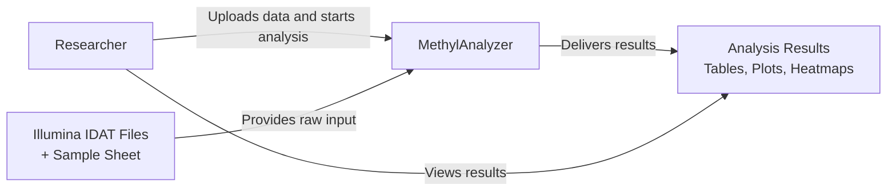
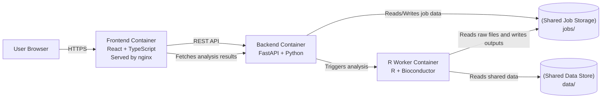
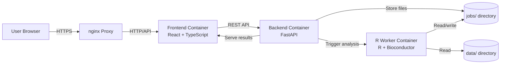
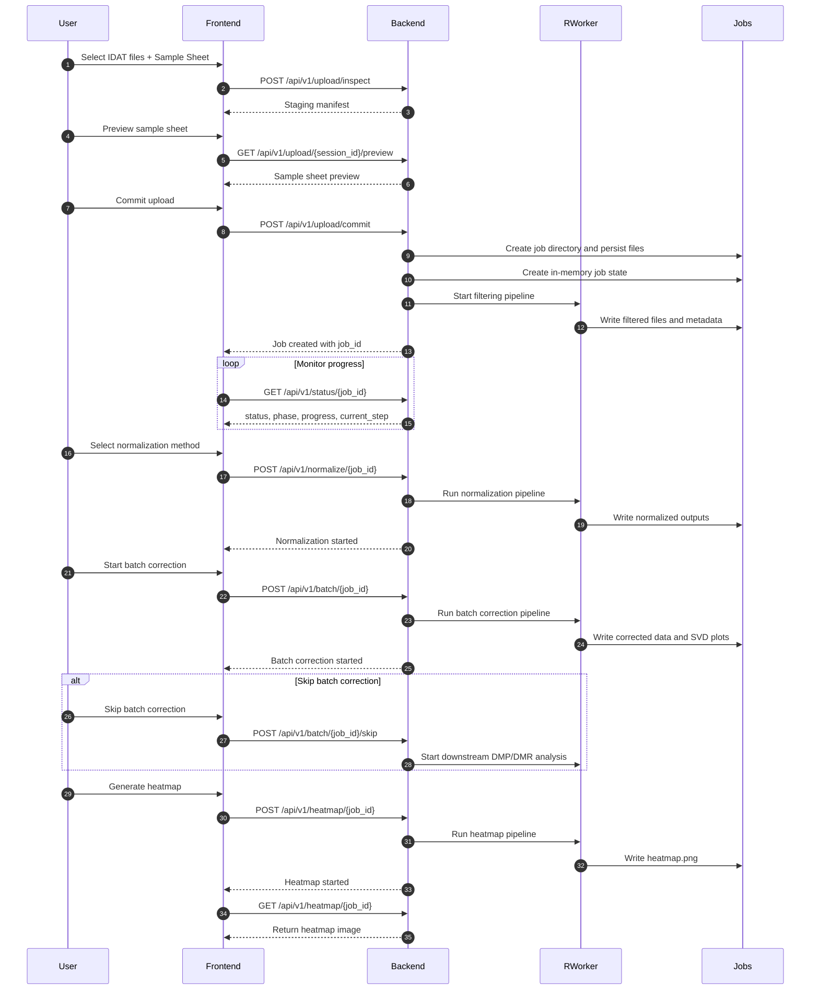

# System Overview

## Executive Summary

This document describes the current implementation of the `swtp-ss26-bigtom` project, a containerized DNA methylation analysis platform built around three core components:

- `frontend/`: React + TypeScript UI
- `backend/`: FastAPI API and job orchestration
- `r_backend/`: R scripts and analysis worker

The system enables researchers to upload Illumina IDAT data, validate and preprocess it, preview normalization, execute batch correction, perform differential methylation analysis, and inspect visual results.

This overview is intentionally focused on the implemented repository structure and runtime behavior. It is not a production specification, and the current implementation is best suited for local development or research usage.

---

## 1. Purpose and Scope

The purpose of this overview is to align the runtime architecture with the actual project structure, clarify responsibilities, and document known limitations.

This repository is organized to separate:

- user interaction (`frontend/`)
- application logic and orchestration (`backend/`)
- scientific computation (`r_backend/`)

This document documents what is implemented today, what is not implemented, and the boundaries of the current system.

---

## 2. Project Components

### Frontend

Location: `frontend/app`

The frontend provides the browser-based user experience.

Responsibilities:

- Upload interface for IDAT files and sample sheets
- Workflow steps for filtering, normalization, batch correction, and analysis
- Result visualization for plots, tables, and heatmaps
- Status polling for background job progress

Key files:

- `frontend/app/index.html`
- `frontend/app/package.json`
- `frontend/app/src/`
- `frontend/app/vite.config.ts`
- `frontend/app/tailwind.config.ts`

Status: implemented in the repository. The frontend is built and served through the `frontend` Docker service, optionally behind nginx.

### Backend

Location: `backend/app`

The backend provides the REST API and job orchestration.

Responsibilities:

- Upload validation for IDAT files and sample sheets
- Job staging and directory creation in `jobs/{job_id}`
- Coordination of R worker execution
- Status, stats, normalization, batch, heatmap, reset, and table endpoints
- Cleanup of expired job and staging directories

Key files:

- `backend/app/main.py`
- `backend/app/api/routes/`
- `backend/app/core/`
- `backend/app/models/job.py`
- `backend/app/services/`
- `backend/requirements.txt`

Status: implemented. The backend is configured with CORS for local development and starts cleanup loops in `main.py`.

### R Worker

Location: `r_backend/`

The R worker executes the scientific analysis pipeline.

Responsibilities:

- Initial filtering and sample quality control
- Normalization preview generation
- Normalization and batch correction
- Differential methylation analysis (DMP / DMR)
- Heatmap creation

Key files:

- `r_backend/init_filter.R`
- `r_backend/normalization_preview.R`
- `r_backend/normalize.R`
- `r_backend/batch_correct.R`
- `r_backend/batch_svd.R`
- `r_backend/dmp.R`
- `r_backend/dmr.R`
- `r_backend/heatmap.R`

Status: implemented. The R worker is invoked by the backend and reads/writes files in the shared `jobs/` directory.

### nginx

Location: `nginx/`

This folder contains nginx configuration for serving the frontend and proxying API requests.

Key files:

- `nginx/nginx.conf`
- `nginx/proxy_params`

Status: implemented for local HTTPS proxying.

### Jobs and Data Storage

Location: `jobs/`

The `jobs/` directory stores uploaded datasets and generated analysis outputs. Each job receives a dedicated subdirectory.

Location: `data/`

The `data/` directory is mounted into the R worker and can contain dataset references or shared resources used during analysis.

Status: implemented. These directories are shared between the backend and the R worker.

---

## 3. Implementation Scope, Assumptions, and Risks

This section makes explicit the system boundaries and the current implementation state.

### Assumptions

- The system is intended for local development, research, or prototype workflows.
- Docker is available and accessible from the backend.
- Users are trusted or operate in a controlled environment.
- The current repository is the source of truth for runtime behavior.

### Implemented behavior

- Upload staging and validation.
- Job creation with persisted `jobs/{job_id}` directories.
- R pipeline execution via backend-driven worker invocation.
- Status polling and result retrieval endpoints.
- Cleanup of expired jobs and staging directories.

### Not implemented

- Authentication and authorization.
- Multi-user or tenant isolation.
- Database-backed job state or persistent session management.
- Data encryption at rest.
- Production-grade deployment hardening.

### Key risks

- Job state is split between in-memory runtime state and file-based artifacts. A backend restart may lose progress state and can leave jobs in an inconsistent state.
- Backend access to `/var/run/docker.sock` simplifies execution but introduces significant host-level operational risk.
- Sensitive biological data stored in `jobs/` requires strict access control in production.
- Local development CORS and HTTPS settings are not sufficient for a public-facing deployment.

### Usage boundaries

This document describes a prototype/local research deployment, not a production environment. For production use, add secure user access, hardened deployment, and reliable state persistence.

---

## 4. Component Summary Table

| Component | Responsibility | Inputs | Outputs | Dependencies | Status |
| --- | --- | --- | --- | --- | --- |
| Frontend | User interaction and workflow UI | IDAT files, Sample Sheet, API responses | REST requests, visualization | Browser, Backend API | Implemented |
| Backend | API, validation, orchestration | Uploads, status polling, job control | Job artifacts, analysis triggers, API responses | FastAPI, Docker, `jobs/`, R worker | Implemented |
| R Worker | Scientific analysis and plotting | Job files, analysis parameters | Normalized outputs, DMP/DMR results, heatmaps | R, Bioconductor, `jobs/`, `data/` | Implemented |
| Jobs storage | File persistence for jobs | Uploaded data, generated analysis outputs | Persisted job directories | Host filesystem, backend, R worker | Implemented |
| nginx | HTTPS proxy and frontend serving | Browser requests | Served frontend, proxied API traffic | Docker, TLS certs | Implemented for dev |

---

## 5. C4 Context Diagram (Level 1)

This diagram shows the system in its environment and the main external actors.



---

## 6. C4 Container Diagram (Level 2)

This diagram shows the main runtime containers and their responsibilities.



---

## 7. Runtime Architecture



### Job Execution Flow

1. The user uploads paired IDAT files and a sample sheet via the frontend.
2. The frontend sends the request to the backend API.
3. The backend validates files, creates a job directory in `jobs/`, and stores the data.
4. The backend starts R analysis steps through the R worker.
5. The frontend polls job progress using `GET /api/v1/status/{job_id}`.
6. The user can inspect filter statistics, normalization previews, and progress updates.
7. The user continues to normalization, batch correction, and downstream analysis.
8. The R worker writes analysis outputs and plots back to the job directory.
9. The backend exposes results to the frontend and users.
10. Expired jobs are cleaned up by the backend cleanup services.

---

## 8. Deployment Architecture

The application is deployed with Docker Compose using `docker-compose.yml`.

Primary services:

- `frontend`
- `backend`
- `r_worker`

The backend service mounts:

- `./jobs:/app/jobs`
- `./r_backend:/app/r_backend`
- `/var/run/docker.sock:/var/run/docker.sock`

The R worker service mounts:

- `./r_backend:/app/r_backend`
- `./data:/app/data`
- `./jobs:/app/jobs`

The frontend is typically available on `localhost:3000` and the backend API on `localhost:8000`.

### Persistent directories

- `jobs/`: job artifacts, uploads, generated analysis results
- `data/`: shared dataset storage for the R worker
- `certs/`: TLS certificates for HTTPS testing

---

## 9. Repository Structure

```text
.
├── backend/
│   ├── app/
│   │   ├── api/
│   │   ├── core/
│   │   ├── models/
│   │   └── services/
│   ├── tests/
│   ├── Dockerfile
│   └── requirements.txt
├── certs/
├── data/
├── docs/
│   └── architecture/
├── docker-compose.yml
├── frontend/
│   ├── app/
│   └── Dockerfile
├── jobs/
├── nginx/
│   ├── nginx.conf
│   └── proxy_params
├── r_backend/
│   ├── tests/
│   ├── utils/
│   └── *.R
├── scripts/
├── CHANGELOG.md
└── README.md
```

---

## 10. Security Considerations

The current project includes basic protections for local development, but it is not a production-ready secure deployment.

Included controls:

- HTTPS support through nginx configuration
- Container isolation for frontend, backend, and R worker
- Upload validation for IDAT files and sample sheets
- File size and staging validation limits

Important gaps:

- Authentication and authorization are not implemented.
- No per-user or tenant isolation is currently enforced.
- Backend access to the Docker socket increases operational risk and expands the attack surface.
- Sensitive data in `jobs/` is persisted on disk without encryption or fine-grained access control.
- CORS settings are oriented toward local development origins and are not hardened for public deployment.

Production hardening recommendations:

- Add authentication and role-based access control.
- Separate execution from direct `/var/run/docker.sock` access, for example by using a dedicated worker service or container orchestration.
- Encrypt sensitive data at rest and secure access to `jobs/` storage.
- Separate runtime state from persisted job data with a database or reliable state store.
- Harden CORS, API rate limiting, and network boundaries.

---

## 11. Notes and Limitations

- Backend job state is partially held in memory and partially in the filesystem. A backend restart can lose runtime-only state and may require reconciliation.
- Uploaded data may contain sensitive biological information and should be secured in production deployments.
- The backend invokes the R worker through Docker execution. Docker must be available for the full analysis workflow.
- The current implementation does not include authentication, authorization, or multi-user isolation.
- Error-handling details, failure modes, and failure recovery are not fully documented in this overview.

---

## 12. Analysis Workflow Sequence Diagram

This diagram reflects the staged upload workflow and the main analysis steps.



---

## 13. Summary

MethylAnalyzer is organized as a containerized application with a clear separation of concerns:

- `frontend/` handles user interaction and visualization.
- `backend/` manages API endpoints, validation, job orchestration, and cleanup.
- `r_backend/` performs scientific methylation analysis in a reproducible R environment.

The current architecture supports local development and reproducible analysis workflows. The added scope, assumptions, and risk sections clarify what is implemented today and what would be required for a production deployment.
