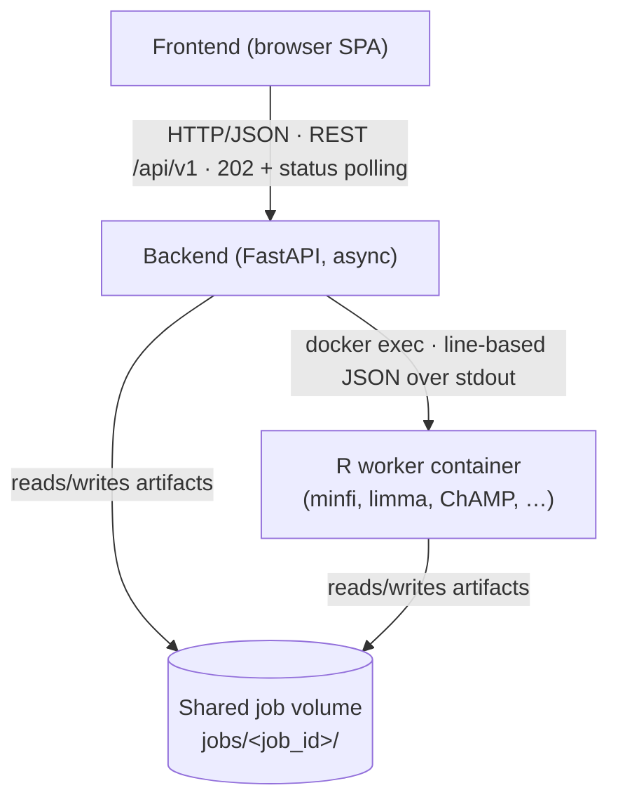

# Architecture Specification: Backend

**Scope:** `backend/app/` — the FastAPI application that orchestrates the DNA-methylation analysis pipeline.
**Audience:** Backend developers · reviewers · maintainers · new team members · supervisors
**Status:** Stable
**Last reviewed:** 2026-07-08

> This document is the **reference architecture** and the **central entry point** for the backend documentation. It explains how the backend is structured and *why*, and how its parts interact — at an architectural level. It deliberately does **not** repeat implementation detail that a dedicated document already owns; instead it introduces each topic and links to the page responsible for it ([§11](#11-documentation-map)).

---

## Table of Contents

- [1. Purpose & Architectural Principles](#1-purpose--architectural-principles)
- [2. Technology Stack](#2-technology-stack)
- [3. System Context](#3-system-context)
- [4. Layered Architecture](#4-layered-architecture)
- [5. The Layers](#5-the-layers)
- [6. Cross-Cutting Concerns](#6-cross-cutting-concerns)
- [7. Reference Flow: Upload => Preview](#7-reference-flow-upload--preview)
- [8. Runtime & Deployment](#8-runtime--deployment)
- [9. Extension Points](#9-extension-points)
- [10. Architecture Decisions & Known Boundaries](#10-architecture-decisions--known-boundaries)
- [11. Documentation Map](#11-documentation-map)

---

## 1. Purpose & Architectural Principles

The backend is an **asynchronous HTTP API** that drives a multi-step methylation-analysis pipeline: *filtering => normalization => batch correction => differential analysis => heatmap*. The numerically heavy work is **not** done in Python. It is delegated to R scripts that run in a separate Docker container. The backend's responsibility is **orchestration**: accept uploads, sequence the pipeline, track each job's state, stream progress to the frontend, and serve the resulting artifacts.

The architecture is organized around four principles:

1. **Orchestration, not computation.** Python coordinates; R computes. The boundary between the two is narrow and explicit ([§3](#3-system-context)), which keeps the Python codebase small and the numerical code independently testable and replaceable.
2. **Strict layering with a one-way dependency rule.** Every module belongs to exactly one layer, and dependencies only ever point downward ([§4](#4-layered-architecture)). This keeps the blast radius of a change local and makes the codebase navigable.
3. **Uniform asynchronous execution.** Long-running work never blocks a request. Every pipeline step follows the same *validate => transition => schedule => 202* pattern ([§6.2](#62-asynchronous-pipeline-execution)), so a new step is added by following an existing one, not by inventing a mechanism.
4. **Explicit, enforced job state.** A job is a small state machine. Every state change goes through a single guarded function, so illegal transitions are impossible by construction ([§6.1](#61-job-lifecycle--state-machine)).

The combined effect is that a component can be understood, reviewed, tested, or extended in isolation.

---

## 2. Technology Stack

| Technology | Role |
|---|---|
| [Python](https://www.python.org/) 3.11 | Backend language |
| [FastAPI](https://fastapi.tiangolo.com/) | Async HTTP framework, routing, validation, OpenAPI |
| [Pydantic](https://docs.pydantic.dev/) v2 | Request/response schemas and the domain model |
| [Uvicorn](https://www.uvicorn.org/) | ASGI server (single process, one event loop) |
| [pandas](https://pandas.pydata.org/) | Loading, filtering and paginating the result tables |
| [Docker](https://www.docker.com/) | Process isolation for the R worker (invoked via `docker exec`) |
| [pytest](https://docs.pytest.org/) | Test suite — see [testing-strategy.md](../testing/testing-strategy.md) |

Concrete versions are pinned in `backend/requirements.txt`; this table names the major version the architecture assumes. Configuration is entirely environment-driven — see [configuration.md](../backend/configuration.md).

---

## 3. System Context

The platform is three cooperating containers plus a shared volume. The backend sits between the browser and the R worker.



The backend and the R worker communicate over **exactly two channels**:

1. **Control** — the backend launches R with `docker exec <container> Rscript …` and reads its stdout/stderr. R streams structured progress as one JSON object per line ([§6.4](#64-r-execution--progress-protocol)).
2. **Data** — both sides exchange files through the shared `jobs/<job_id>/` directory. This file contract is the actual integration surface and is specified in [job-directory-layout.md](../contracts/job-directory-layout.md).

The full C4 context/container diagrams and the end-to-end sequence live in [System_Overview.md](./System_Overview.md); this section is the orientation subset.

---

## 4. Layered Architecture

The application is a classic layered architecture. Directories map one-to-one onto layers.

```text
backend/app/
├── main.py                 # Composition root: app, CORS, exception handler, lifespan
├── api/routes/             # HTTP adapters (one router per domain)
├── services/               # Business logic: orchestration, domain/IO, infrastructure
│   └── r_executor/         # The only subsystem that runs R
├── models/                 # Pydantic schemas + the JobStatus domain model
└── core/                   # Cross-cutting: config, errors, logging, resource governor, atomic IO
```

| Layer | Directory | Responsibility | Must **not** |
|---|---|---|---|
| **API / Routes** | `app/api/routes/` | HTTP adapter: validate input, map errors to HTTP, perform the initial state transition, schedule the pipeline, serve artifacts. | Contain R calls, heavy file I/O, or multi-step orchestration. |
| **Services** | `app/services/` | All business logic: pipeline orchestration, domain/IO helpers, and runtime infrastructure (state, execution, cleanup). | Depend on FastAPI request/response objects. |
| **Models** | `app/models/` | Pydantic schemas for the HTTP contract and the `JobStatus` domain object. | Contain behaviour beyond validation. |
| **Core** | `app/core/` | Cross-cutting concerns: configuration, error model, logging, resource governance, atomic persistence. | Depend on routes or services. |
| **R backend** | `r_backend/` *(separate process)* | Numerical computation. | — |

**Dependency rule.** Dependencies point downward only: routes => services => core; services may use other services; core depends on nothing inside the app. The R backend is reached **exclusively** through the `r_executor` subpackage ([§5.5](#55-r-execution)). This rule is what keeps the layers meaningful, and it is the first thing a reviewer should check.

---

## 5. The Layers

This section describes each layer's role at an architectural level. Per-module signatures, parameters, side effects and dependencies are the domain of [services-reference.md](../backend/services-reference.md); the tables below are for orientation only.

### 5.1 API — `app/api/routes/`

Each router is a **thin HTTP adapter**. It validates the request (Pydantic + guards), performs the single synchronous state transition into a `RUNNING` state, schedules the background pipeline, and returns `202 Accepted`. Artifact endpoints (`GET`) stream files back with the correct content type. Routers never orchestrate multi-step work and never call R directly.

| Router | Endpoints | Purpose |
|---|---|---|
| `upload.py` | `POST /upload/inspect`, `GET /upload/{sid}/preview`, `POST /upload/commit`, `DELETE /upload/{sid}`, `POST /upload` *(deprecated)* | Two-phase folder/ZIP upload (inspect => commit) plus the legacy single-shot upload. Starts the filtering => normalization-preview pipeline. |
| `status.py` | `GET /status/{job_id}` | The job's current `JobStatus` (the frontend polls this). |
| `stats.py` | `GET /filter/{job_id}/stats` | Serve `filter_stats.json`. |
| `normalization_preview.py` | `GET /preview/normalization/{job_id}`, `…/{plot_name}` | Serve the preview manifest and PNGs. |
| `normalize.py` | `POST /normalize/{job_id}` | Run normalization with a chosen method, then SVD round 0. |
| `batch.py` | `POST /batch/{job_id}`, `…/skip`, `GET …/history`, `…/svd-plot/{n}`, `…/batch-options` | Run/iterate batch correction; enter downstream analysis. |
| `heatmap.py` | `POST /heatmap/{job_id}`, `GET …`, `…/options` | Generate and serve the heatmap. |
| `reset.py` | `POST /reset/{job_id}` | Cancel a running job and delete it. |
| `table.py` | `GET /table/{job_id}/{table}`, `…/export` | Paginated, filterable DMP/DMR result tables and CSV export. |

`main.py` additionally exposes `GET /` (identity) and `GET /health` (liveness/readiness probe). The complete request/response contract, including the RFC 9457 error format, is specified in [api-contract.md](../api/api-contract.md).

### 5.2 Services — `app/services/`

The service layer holds three conceptual roles. The split is by responsibility, not by sub-folder.

**(a) Pipeline orchestration** — `async` coroutines that sequence R steps and state transitions. Each receives a `cancel_event` and never manages its own task lifecycle (that belongs to `pipeline_task`, [§6.2](#62-asynchronous-pipeline-execution)). Examples: `upload_service`, `normalize_service`, `normalization_preview_service`, `batch_service`, `heatmap_service`.

**(b) Domain / IO helpers** — pure, synchronous utilities: upload validation/persistence, the two-phase upload machinery, sample-sheet parsing/canonicalization, and result-table loading/filtering.

**(c) Infrastructure** — the runtime backbone: job state, background-task lifecycle, reset, cleanup, and R execution.

The table below lists every module with its one-line responsibility. For full public-function signatures, file-I/O side effects, exceptions raised, and per-module dependencies, see [services-reference.md](../backend/services-reference.md).

| Module | Responsibility | Group |
|---|---|---|
| `job_manager` | In-memory job registry and state machine — the single source of truth for every job's `(phase, status)`, cancel events, and task references. | infra |
| `job_paths` | Central, path-safe resolution of `JOBS_DIR / job_id`; shared by every service that reads or writes job artifacts. | infra |
| `pipeline_task` | Owns the background-task lifecycle: creates the `cancel_event`, registers/clears the task, guarantees cleanup in `finally`. | infra |
| `pipeline_outcome` | Shared translation of a finished R step's result into cancel / timeout / failure state transitions; ensures uniform behaviour across all pipeline steps. | infra |
| `reset_service` | Cooperatively cancel a running pipeline and permanently delete the job; idempotent and concurrency-safe. | infra |
| `job_cleanup_service` | TTL-based background sweep that deletes expired job and staging directories by `mtime`. | infra |
| `r_executor/` | Subprocess execution of R commands via `docker exec` ([§5.5](#55-r-execution)). | infra |
| `upload_service` | Legacy single-shot upload: persist all files with rollback, then run the filtering → normalization-preview pipeline. | orchestration |
| `upload_inspect_service` | Inspect phase of the two-phase upload: stage files safely, classify IDATs and sample sheets, return a manifest. No pipeline runs here. | orchestration |
| `upload_commit_service` | Commit phase of the two-phase upload: validate the column-role mapping and file selection, move files into a job directory, create the job. | orchestration |
| `normalize_service` | Run `normalize.R` for the chosen method (or copy the filtered data for `raw`), then produce the round-0 SVD plot. | orchestration |
| `normalization_preview_service` | Run `normalization_preview.R`, scan for produced artifacts, write `preview_plots.json`. | orchestration |
| `batch_service` | Run batch correction + SVD plot per round; run downstream differential analysis (beta extraction → DMR → DMP). | orchestration |
| `heatmap_service` | Apply DMP filters to select CpGs, write `heatmap_input.csv`, run `heatmap.R`. | orchestration |
| `staging_manager` | Lifecycle of temporary upload staging sessions (UUID-keyed, TTL-bounded, path-validated). | domain |
| `archive_utils` | Safe ZIP extraction: guards against Zip-Slip, symlinks, zip-bomb expansion, and disallowed member types. | domain |
| `samplesheet_normalizer` | Convert any upload (CSV/XLSX, any delimiter, any column names) into the one canonical `SampleSheet.csv`. | domain |
| `samplesheet_parser` | Locate and parse the canonical `SampleSheet.csv` inside a job directory. | domain |
| `file_handler` | Validate and persist uploaded IDAT files and sample sheets; create and remove job directories. | domain |
| `intake_guards` | Enforce deployment-wide resource budgets at upload time: sample count, total jobs-directory size, and free disk space. | domain |
| `table_handler` | Load a result CSV into pandas, apply filters, sort, paginate, and export. | domain |
| `table_filter` | Shared filter engine: maps filter keys to DataFrame column/operator pairs for DMP and DMR tables (and the heatmap CpG selection). | domain |

### 5.3 Models — `app/models/`

Pydantic schemas, **one module per domain** (`job`, `upload`, `normalize`, `filter`, `batch`, `heatmap`, `table`). `JobStatus` is the in-memory domain object the state machine mutates; the `*Response`/`*Request` models are the HTTP contract validated at the boundary. Models carry no behaviour beyond validation.

### 5.4 Core — `app/core/`

Cross-cutting concerns with no dependency on routes or services:

- `config` — environment-driven configuration, validated at import (fail-fast). See [configuration.md](../backend/configuration.md).
- `error_types` / `exceptions` — the RFC 9457 problem model, `AppException`, and the FastAPI handler ([§6.6](#66-error-model)).
- `logging_config` — structured logging setup; see [logging-backend.md](../backend/logging-backend.md).
- `resource_governor` — the admission-control queue that bounds concurrent R memory/CPU usage ([§6.5](#65-resource-governance--intake-guards)).
- `atomic_io` — crash-safe JSON persistence (temp file + `os.replace`), used for job artifacts that must never be left half-written.
- `upload_limits` — the single source of truth for upload size/count/allow-list limits.

### 5.5 R execution

The `app/services/r_executor/` subpackage is the **only** subsystem that knows how to run R. It hides the `docker exec` mechanics behind a small, uniform interface so pipeline services stay free of subprocess concerns. `run_r_script(command, cancel_event, on_progress)` starts the subprocess, streams and parses its output, enforces the per-command timeout, honours cancellation, and resolves to one `ExecutionResult`. Each R script is represented by an `RCommand` dataclass (Command pattern) that builds its own argv and declares its resource weight.

This subsystem has its own dedicated specification — see [r-executor.md](./r-executor.md). Do not add subprocess logic elsewhere.

---

## 6. Cross-Cutting Concerns

Each concern below is described at the architectural level (what it is, why it exists) and points to the document that owns the detail.

### 6.1 Job lifecycle & state machine

A job is a `(phase, status)` pair plus progress metadata, held in `job_manager`. **Every** state change goes through `transition_job()`, which validates the move against an explicit allowed-transition graph; an illegal move raises `InvalidTransitionError` => HTTP 409. This makes the reachable states explicit and prevents inconsistent transitions under concurrency. Terminal statuses are `waiting`, `running`, `completed`, `failed`; recovery edges let a user retry a failed step without re-running the whole pipeline.

The full state table, the diagram, and who triggers each transition (route vs. pipeline task) are specified in [job-lifecycle.md](./job-lifecycle.md).

### 6.2 Asynchronous pipeline execution

Pipeline steps take minutes, so routes never block on them. The pattern is uniform and mandatory:

1. The route validates input and performs the **initial** `transition_job` into a `RUNNING` state *synchronously*, so a follow-up status poll cannot race ahead.
2. The route schedules the pipeline through `pipeline_task`, passing a factory `lambda cancel_event: <service_coroutine>(…, cancel_event)`.
3. The route returns `202 Accepted` immediately.
4. `pipeline_task` creates the `cancel_event`, registers the task, runs the coroutine, and clears both registrations in a `finally` block.

Services therefore never create a `cancel_event` or register a task themselves — that responsibility lives in exactly one place. The frontend observes progress by polling `GET /status/{job_id}`; the progress contract is defined in [pipeline-progress.md](./pipeline-progress.md).

### 6.3 Cancellation & reset

Cancellation is **cooperative**. `POST /reset/{job_id}` delegates to `reset_service`, which sets the job's `cancel_event`; the running pipeline observes it, the executor terminates the R subprocess, the service returns cleanly, and the job directory is deleted. Only the executor ever kills the R process. While a reset is in progress the job is flagged in `resetting_jobs`, which turns any trailing `transition_job`/`set_progress` into a silent no-op so a finishing task cannot revive a job that is being deleted. See [r-executor.md](./r-executor.md) for the cancellation protocol.

### 6.4 R execution & progress protocol

R scripts emit one JSON object per stdout line (`progress`, `error`, `done`, `plot`). The executor parses these, forwards them to the caller's `on_progress` callback (which usually updates `job_manager`), and captures the last structured error so the API can surface a real cause instead of a raw stderr dump. A non-zero exit maps to a `FAILED` result; an exceeded timeout to `TIMEOUT`. The mechanics are owned by [r-executor.md](./r-executor.md); the JSON event contract by [pipeline-progress.md](./pipeline-progress.md).

### 6.5 Resource governance & intake guards

Because every R step runs inside the single R-worker container, unbounded concurrent uploads would oversubscribe host RAM and trigger the OOM-killer. Two mechanisms prevent this:

- **Admission control** (`core/resource_governor`) — a weighted queue that admits an R step only once its estimated memory and CPU-core need fits the remaining budget; otherwise the step *queues* until capacity frees up (graceful slow-down instead of a crash).
- **Intake guards** (`services/intake_guards`) — reject a job at upload time if it would exceed the per-job sample cap or the total job-disk budget, giving the user a clear early error instead of a mid-pipeline failure.

Both are sized from environment configuration ([configuration.md](../backend/configuration.md)); the hard container `mem_limit` is the last-resort backstop. 
### 6.6 Error model

All API errors are **RFC 9457 Problem Details**. Domain code raises `AppException` (or its subclasses such as `InvalidTransitionError`); a single FastAPI handler renders them to the correct status code and `application/problem+json` body. Routes therefore do not assemble error responses by hand. The error catalogue and examples are part of [api-contract.md](../api/api-contract.md).

### 6.7 Configuration

Every tunable is read from an environment variable with a validated default at import time, so the same image runs unchanged across dev/CI/production and a misconfiguration fails fast. The full variable reference (name, default, unit, effect, validation) is [configuration.md](../backend/configuration.md), kept in sync with `.env.example` and `docker-compose.yml`.

### 6.8 Logging

Logging is structured (printf-style, `key=value`), configured centrally, and level-controlled by environment. Conventions and the rationale are in [logging-backend.md](../backend/logging-backend.md).

### 6.9 Data & storage contracts

The backend's most important external contracts are file contracts:

- **Job directory layout** — which file each phase writes and which route reads it: [job-directory-layout.md](../contracts/job-directory-layout.md).
- **Sample sheet** — the canonical Illumina CSV every upload is normalized to, and the four role mappings: [samplesheet-spec.md](../contracts/samplesheet-spec.md).
- **Filter mapping** — the end-to-end filter contract (frontend field => query param => backend operator => R column): [filter-mapping.md](../contracts/filter-mapping.md).

### 6.10 Security

Path-traversal defence (UUID/segment-validated job and session ids), safe archive extraction, magic-byte/size file validation, the two-phase upload (nothing enters `jobs/` without confirmation), CORS, and the Docker-socket trade-off are collected in [security.md](../backend/security.md).

### 6.11 Cleanup & retention

Two lifespan-managed background loops delete expired `jobs/<id>/` and `staging/<id>/` directories by mtime, off the event loop. Retention windows are configurable. This is also the data-retention (GDPR) mechanism; see [security.md](../backend/security.md) and [job-lifecycle.md](./job-lifecycle.md).

---

## 7. Reference Flow: Upload => Preview

The representative flow below shows the uniform pattern; every other pipeline entry point (`/normalize`, `/batch`, `/heatmap`) has the same shape. Only the architectural steps are shown — the wire-level contract is in [api-contract.md](../api/api-contract.md).

```text
POST /upload/inspect         => classify a staged folder/ZIP (staging session), return the manifest
GET  /upload/{sid}/preview   => preview a candidate sample sheet for role mapping
POST /upload/commit          => validate the selection + intake guards; move the chosen files into
                               jobs/<job_id>/; create the job; start the pipeline; return 201

[background] pipeline_task.run_job_pipeline
  └─ register cancel_event + task
     upload_service.run_upload_pipeline(cancel_event):
        transition FILTERING/RUNNING
        run_r_script(FilteringCommand)            => init_filter.R  => filter_stats.json, filtered_data.rds
        transition FILTERING/COMPLETED => NORMALIZATION_PREVIEW/RUNNING
        run_normalization_preview(cancel_event):
            run_r_script(NormalizationPreviewCommand) => *.png / *.json
            scan artifacts => preview_plots.json
            transition NORMALIZATION_PREVIEW/COMPLETED => NORMALIZATION/WAITING
     finally: unregister cancel_event + task

Frontend polls GET /status/{job_id} throughout.
```

The legacy `POST /upload` performs inspect+commit in a single request and remains for backwards compatibility; new clients use the two-phase flow.

---

## 8. Runtime & Deployment

- **Process model.** A single Uvicorn/FastAPI process with one event loop. All job state is **in-memory**; pipeline steps are asyncio tasks on that loop. A restart loses in-flight job state but not the files on disk.
- **R worker.** A long-lived Docker container the backend `exec`s into. The backend must reach the Docker socket to launch R.
- **Shared storage.** `jobs/<job_id>/` is a volume visible to both the backend (host path) and the R worker (container path); `RCommand` objects translate between the two path views. `staging/<id>/` is a sibling volume for unconfirmed uploads, enabling an atomic move on commit.
- **Durability.** Files on the volume are durable until TTL cleanup; in-memory job state is ephemeral.

The container topology, volumes, the Docker-socket rationale, and R-worker specifics are documented in [docker.md](../deployment/docker.md); TLS/reverse-proxy in [https-nginx.md](../deployment/https-nginx.md).

---

## 9. Extension Points

The architecture is designed so common changes follow an existing template rather than inventing a mechanism.

- **New endpoint.** Add a router in `app/api/routes/` and a Pydantic model in `app/models/`; keep it thin; raise `AppException` for errors. Register it in `main.py`.
- **New pipeline step.** Add an `RCommand` subclass in `r_executor/commands/`, a service coroutine that takes `cancel_event`, the new `(phase, status)` transitions to the state machine, and schedule it via `pipeline_task`. **Never** modify `executor.py` for a new step.
- **State change.** Only through `transition_job` / `set_progress`. Never mutate `JobStatus` directly.
- **Background work.** Only through `pipeline_task`. Never create the `cancel_event` or register the task in a service or route.
- **Configuration.** Add the variable to `core/config` with a validated default and document it in [configuration.md](../backend/configuration.md); mirror it in `.env.example` / `docker-compose.yml`.
- **Logging.** Structured `key=value`, per [logging-backend.md](../backend/logging-backend.md). No f-strings in log calls, no `print`.

---

## 10. Architecture Decisions & Known Boundaries

The key decisions that shape the whole system are, notably: R via `docker exec` rather than an embedded process or HTTP service; file-based communication over a shared volume rather than a database/queue; in-memory job state + polling rather than WebSockets/persistence; the two-phase upload; the `RCommand` pattern; and the RFC 9457 error format.

The following are **deliberate boundaries, not defects**:

- **Single-process, in-memory state.** No horizontal scaling; a restart loses in-flight job state (files survive). Acceptable for the current single-instance deployment. Introducing an external store (Redis/DB) behind a repository seam is the path to scaling.
- **Docker coupling.** The backend requires access to the Docker socket to `exec` into the worker — a documented trade-off (see [security.md](../backend/security.md)).