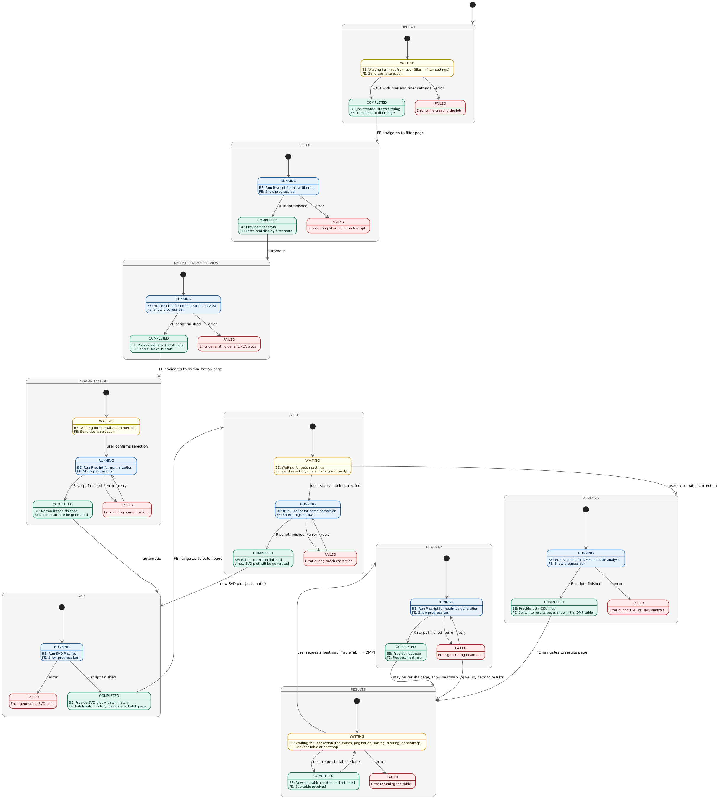

# Architecture Specification: Job Lifecycle & State Machine

**Scope:** `app/services/job_manager.py`, `app/services/reset_service.py`, `app/models/job.py`, React frontend polling logic  

---

## Table of Contents

- [1. Introduction](#1-introduction)
- [2. State Space](#2-state-space)
  - [2.1 Status Values](#21-status-values-jobstatusvalue)
  - [2.2 Phase Values](#22-phase-values-jobphase)
  - [2.3 State Matrix](#23-state-matrix)
  - [2.4 State Machine Diagram](#24-state-machine-diagram)
  - [2.5 Recovery from Failed](#25-recovery-from-failed)
  - [2.6 Job Data Fields](#26-job-data-fields)
- [3. Backend Integration](#3-backend-integration)
  - [3.1 Creating a Job](#31-creating-a-job)
  - [3.2 Triggering Transitions](#32-triggering-transitions)
  - [3.3 Querying a Job](#33-querying-a-job)
  - [3.4 Resetting a Job](#34-resetting-a-job)
- [4. R Script Integration](#4-r-script-integration)
- [5. Frontend Integration](#5-frontend-integration)
  - [5.1 Progress Bar](#51-progress-bar)
  - [5.2 Page Navigation](#52-page-navigation)
  - [5.3 WAITING States](#53-waiting-states)
  - [5.4 Heatmap Guard](#54-heatmap-guard)
- [6. Error and Edge Cases](#6-error-and-edge-cases)
- [7. Extension Points](#7-extension-points)
- [8. Developer Checklist](#8-developer-checklist)
- [9. Cross-links](#9-cross-links)

---

## 1. Introduction

A MethylAnalyzer job moves through a fixed sequence of pipeline steps — from file upload through normalization, batch correction, and downstream analysis to the final results view. Managing this progression reliably requires a clearly defined state model that all three system layers (R scripts, FastAPI backend, React frontend) agree on.

The previous approach represented job state as free-form strings (e.g. `"normalization_done"`), which mixed phase and status into a single opaque value. This made allowed transitions impossible to enforce, introduced typo risk, and gave the frontend no reliable basis for navigation decisions.

The current design separates job state into two orthogonal dimensions:

- **Phase** (`JobPhase`): the pipeline step the job is currently in — *where is the user?*
- **Status** (`JobStatusValue`): the operational state of the background process within that phase — *is code running?*

A job is fully described by the tuple `(phase, status)`. All transitions are validated against an explicit allow-list (`_ALLOWED_TRANSITIONS`). Any invalid transition raises `InvalidTransitionError` rather than silently corrupting state.

---

## 2. State Space

### 2.1 Status Values (`JobStatusValue`)

| Value | Description |
|---|---|
| `running` | A background process (typically an R script) is executing. The backend does not return the result synchronously; the frontend must poll `GET /api/v1/status/{job_id}` and display a progress bar until the status changes. |
| `waiting` | The phase is complete and the backend is waiting for a user action before proceeding. |
| `completed` | The phase finished successfully. The backend transitions automatically to the next phase. |
| `failed` | An error occurred within the phase. In most phases this is a terminal state (recovery only via `/reset`). |

### 2.2 Phase Values (`JobPhase`)

| Value | Description |
|---|---|
| `uploaded` | Entry state. The upload endpoint has accepted the files and created the job. The pipeline has not yet started. |
| `filtering` | The initial filter R script is executing. When done, filter statistics are available and the normalization preview begins automatically. |
| `normalization_preview` | The normalization preview R script generates density and PCA plots. The user can proceed to the normalization page once this completes. |
| `normalization` | The user selects a normalization method and submits it. The normalization R script runs; on success the SVD plot is generated automatically. |
| `svd` | The SVD plot R script runs. On success the job transitions to the batch correction page. |
| `batch` | The user either configures batch correction (R script runs, then SVD repeats) or skips directly to downstream analysis. |
| `analysis` | DMP and DMR analysis scripts execute. On success the results page becomes available. |
| `results` | The user views and filters result tables and may request a heatmap (DMP tab only). |
| `heatmap` | The heatmap R script executes. On success the heatmap is served; the job returns to `results+waiting`. |

### 2.3 State Matrix

Cells marked **—** are invalid states that do not exist in the transition graph.

| Phase | `waiting` | `running` | `completed` | `failed` |
|---|---|---|---|---|
| **uploaded** | **Entry point.** Awaiting file upload and filter settings from the user. => `uploaded+completed` \| `uploaded+failed` | — | Job created successfully; pipeline starts. => `filtering+running` | Error creating the job. Terminal. |
| **filtering** | — | From `uploaded+completed`. Runs `init_filter.R`. => `filtering+completed` \| `filtering+failed` | Filter statistics ready; normalization preview starts automatically. => `normalization_preview+running` | R script error. Terminal. |
| **normalization_preview** | — | From `filtering+completed`. Runs normalization preview R script (density + PCA plots). => `normalization_preview+completed` \| `normalization_preview+failed` | Preview plots ready; user can advance. => `normalization+waiting` | R script error. Terminal. |
| **normalization** | From `normalization_preview+completed`. Awaiting method selection from the user. => `normalization+running` | From `normalization+waiting`. Runs normalization R script. => `normalization+completed` \| `normalization+failed` | Normalization successful; SVD plot starts. => `svd+running` | R script error. **Retryable** — user selects a different method. => `normalization+running` |
| **svd** | — | From `normalization+completed` or `batch+completed`. Runs SVD plot R script. => `svd+completed` \| `svd+failed` | SVD plot ready; batch history available. => `batch+waiting` | R script error. Terminal. |
| **batch** | From `svd+completed`. Awaiting batch correction settings or skip action. => `batch+running` \| `analysis+running` | From `batch+waiting`. Runs `batch_correct.R`. => `batch+completed` \| `batch+failed` | Batch correction done; new SVD plot generated. => `svd+running` | R script error. **Retryable** — user adjusts settings. => `batch+running` |
| **analysis** | — | From `batch+waiting` (skip) or `batch+completed` => SVD => batch+waiting (skip). Runs DMR and DMP R scripts. => `analysis+completed` \| `analysis+failed` | Both result tables available. => `results+waiting` | R script error. Terminal. |
| **results** | From `analysis+completed`. Awaiting table interaction (filter, sort, paginate, tab switch) or heatmap request. => `results+completed` \| `results+failed` \| `heatmap+running` | — | Table data served. => `results+waiting` | Error serving table data. Terminal. |
| **heatmap** | — | From `results+waiting`. Runs heatmap R script. => `heatmap+completed` \| `heatmap+failed` | Heatmap available. => `results+waiting` | R script error. **Retryable** — adjust filter settings and retry, or return to results. => `heatmap+running` \| `results+waiting` |

### 2.4 State Machine Diagram



### 2.5 Recovery from Failed

In most phases `failed` is a terminal state — the only recovery path is `POST /api/v1/reset/{job_id}`, which deletes the job and all its data so the user can start over.

Three phases allow retrying without a full reset:

| Phase | Allowed recovery transition | Rationale |
|---|---|---|
| `normalization` | `normalization+failed` => `normalization+running` | The user may have selected an unsuitable normalization method. Choosing a different method and resubmitting is sufficient without re-uploading the data. |
| `batch` | `batch+failed` => `batch+running` | Same rationale — different batch correction settings may succeed. |
| `heatmap` | `heatmap+failed` => `heatmap+running` | The DMP/DMR results already exist; a heatmap failure is often caused by filter settings. Adjusting filters and retrying avoids discarding the entire analysis. |
| `heatmap` | `heatmap+failed` => `results+waiting` | The user can abandon the heatmap and continue working with the result tables. |

All other `failed` states — `filtering`, `normalization_preview`, `svd`, `analysis`, `results` — are true terminal states with no transition back to `running`.

### 2.6 Job Data Fields

Jobs exist exclusively in memory (`jobs: dict[str, JobStatus]`). There is no database and no persistence layer. A backend restart clears all job records; subsequent requests for a previously known job receive HTTP 410 (Gone), not 404.

The `JobStatus` Pydantic model holds exactly the following fields — no additional fields are stored:

```
job_id:           str        # UUID assigned at upload time
status:           str        # JobStatusValue enum value (e.g. "running")
phase:            str        # JobPhase enum value (e.g. "normalization")
progress_percent: int        # 0–100; updated via set_progress() or transition_job()
current_step:     str        # Human-readable status line for the progress bar
error:            dict|None  # Populated only when status == "failed"
```

---

## 3. Backend Integration

### 3.1 Creating a Job

The upload endpoint creates a new job record immediately after persisting the uploaded files to disk. The initial state is always `(uploaded, waiting)`.

```python
from app.services.job_manager import create_job

job = create_job(job_id=str(uuid4()))
```

The job record does not store the job directory path. Directory resolution is handled separately via `job_paths.resolve_job_dir(JOBS_DIR, job_id)`.

### 3.2 Triggering Transitions

All phase and status changes must go through `transition_job()`. Direct writes to `job.phase` or `job.status` are forbidden.

```python
from app.services.job_manager import transition_job, JobPhase, JobStatusValue

transition_job(
    job_id,
    new_phase=JobPhase.FILTERING,
    new_status=JobStatusValue.RUNNING,
    current_step="Running initial filter...",
)
```

**Error behaviour:**

| Condition | Result |
|---|---|
| Transition not in `_ALLOWED_TRANSITIONS` | `InvalidTransitionError` raised; job state unchanged |
| Job not in memory (backend restarted) | `JobSessionExpiredError` raised => HTTP 410 Gone |
| Job is currently being reset | Transition silently dropped — no error, no state update |

**Granular progress updates** within a running phase (no phase or status change):

```python
from app.services.job_manager import set_progress

set_progress(job_id, percent=42, message="Loading beta matrix...")
```

`set_progress()` is used by R script progress callbacks to drive the progress bar without triggering a full state transition.

### 3.3 Querying a Job

```python
from app.services.job_manager import get_job

job = get_job(job_id)
if job is None:
    raise HTTPException(status_code=404, ...)
```

`get_job()` is a pure read with no side effects. Callers must treat `None` as a legitimate return value (the job may not exist or may have been evicted after a backend restart).

### 3.4 Resetting a Job

All teardown logic lives in `reset_service.reset_job()`. Route handlers are thin adapters that call this function and translate the outcome to HTTP.

The reset sequence is strictly ordered — the R subprocess must be stopped *before* the job directory is deleted:

1. **`begin_reset(job_id)`** — Claims an exclusive reset slot. Concurrent reset requests for the same job return immediately with `already_in_progress`. Any trailing `transition_job()` or `set_progress()` calls from the still-draining pipeline task become silent no-ops.
2. **`trigger_cancel(job_id)`** — Sets the cancel event. The R executor detects this and terminates the subprocess cooperatively.
3. **`await _await_task_shutdown()`** — Waits up to 5 seconds for the pipeline task to finish. If it does not respond within the grace period, the task is cancelled hard.
4. **`delete_job()` + `unregister_cancel_event()` + `unregister_job_task()`** — Removes all in-memory registries for this job.
5. **`file_handler.delete_job_files(job_id)`** — Deletes the job directory from disk and verifies it is gone. If deletion fails, `OSError` propagates to the route handler, which returns HTTP 500. Success is never reported while data remains on disk.
6. **`end_reset(job_id)`** — Releases the reset slot. Always executed, even on error.

```python
# Called from the route handler only — never from services directly
outcome = await reset_service.reset_job(job_id)
```

After a successful reset the frontend navigates to the upload page. The next upload request creates a new, independent job.

---

## 4. R Script Integration

Each R script sources `utils/progress.R` and uses its three emit functions exclusively. These functions write structured JSON lines to stdout, which the Python backend parses to update job progress.

```r
source("/app/r_backend/utils/progress.R")

emit_progress(0,   "Script initialized")
emit_progress(50,  "Processing data...")
emit_progress(100, "Processing complete")

emit_done()                          # Signals successful completion
emit_error("Error: <description>")  # Hard abort — calls quit(status=1)
```

R scripts must use `emit_error()` instead of `stop()`. Only `emit_error()` causes the backend to set `status: "failed"` correctly. Using `stop()` directly exits the process without the backend receiving a structured error event.

See [pipeline-progress.md](pipeline-progress.md) for the full stdout protocol specification.

---

## 5. Frontend Integration

The frontend polls `GET /api/v1/status/{job_id}` while a job is in `status: "running"`. The response shape is:

```ts
interface JobStatus {
  job_id:           string;
  status:           "running" | "waiting" | "completed" | "failed";
  phase:            string;
  progress_percent: number;
  current_step:     string;
  error?:           { detail: string };
}
```

### 5.1 Progress Bar

The progress bar component is fully decoupled from phase logic. It renders based solely on three fields:

```tsx
const jobStatus = useJobPolling(jobId);

<ProgressBar
  percent={jobStatus?.progress_percent ?? 0}
  message={jobStatus?.current_step ?? "Waiting for pipeline..."}
  hasError={jobStatus?.status === "failed"}
/>
```

### 5.2 Page Navigation

The frontend treats the backend state as the single source of truth for navigation. Route changes are triggered by phase/status combinations, not by explicit navigation events from the pipeline.

```ts
useEffect(() => {
  if (!jobStatus) return;
  if (jobStatus.phase === "normalization_preview" && jobStatus.status === "completed") {
    navigate(`/normalization/${jobId}`);
  }
}, [jobStatus]);
```

### 5.3 WAITING States

When `status === "waiting"`, the backend is blocked on a user action. The frontend renders a selection form instead of a progress bar:

| Phase | Expected user action |
|---|---|
| `normalization` | Select a normalization method and submit |
| `batch` | Configure batch correction settings and submit, or skip to analysis |
| `results` | Filter, sort, paginate, switch tabs, or request a heatmap |

### 5.4 Heatmap Guard

The transition to `heatmap+running` is only permitted from the DMP results tab. This guard lives exclusively in the frontend — the backend validates the transition but has no knowledge of which tab is active.

```ts
const handleHeatmapRequest = () => {
  if (activeTab !== "DMP") return;  // Guard: heatmap only from DMP tab
  fetch(`/api/v1/heatmap/${jobId}`, { method: "POST" });
};
```

---

## 6. Error and Edge Cases

| Condition | Behaviour |
|---|---|
| Backend restart while a job is running | All job records are lost. The running R subprocess is orphaned (no kill signal is sent). Subsequent status requests return HTTP 410 Gone. The frontend should navigate the user to the upload page. |
| Two concurrent reset requests for the same job | The second request returns immediately with `already_in_progress: true`. Only one teardown runs. |
| Pipeline task ignores the cancel signal | After the 5-second grace period, the task is cancelled hard (`task.cancel()`). The R subprocess may remain briefly until the executor's finally block kills it. |
| Disk full during file deletion | `OSError` propagates to the reset route, which returns HTTP 500. The job record is already removed from memory at this point; subsequent requests return 404 or 410. |
| `transition_job()` called for a job being reset | The call returns `None` silently. This prevents race conditions between the still-draining pipeline task and the reset teardown. |

---

## 7. Extension Points

### Adding a new pipeline phase

1. Add the new value to `JobPhase` in `job_manager.py`.
2. Add all valid inbound and outbound transitions to `_ALLOWED_TRANSITIONS`. Only add what is actually needed — the graph enforces every edge explicitly.
3. Add the corresponding R script and wire its progress callbacks to `set_progress()`.
4. Update the frontend polling logic to handle the new `phase` value (navigation and UI state).
5. Update this document with the new phase row in the State Matrix (§2.3) and any new recovery transitions (§2.5).

### Changing a recovery transition

Edit the relevant entry in `_ALLOWED_TRANSITIONS`. No other code change is needed — the transition graph is the single authority. Update §2.5 to reflect the change.

### Adding persistence

Jobs currently live only in memory. To persist them (e.g. to survive backend restarts):

- Replace the `jobs: dict[str, JobStatus]` store with a database-backed repository.
- Implement `create_job()`, `get_job()`, `delete_job()`, `transition_job()`, and `set_progress()` against the new store while keeping the same function signatures.
- Services and routes do not need to change; they call only these functions and never access the store directly.
- Update the error handling in the frontend: HTTP 410 should no longer occur for persisted jobs (change to 404 or re-hydrate from the database).

---

## 8. Developer Checklist

For every new pipeline step:

1. Use `transition_job()` for phase and status changes — never write to `job.phase` or `job.status` directly.
2. Verify the target state exists in `_ALLOWED_TRANSITIONS` before adding the call. Add the edge if it is missing.
3. Use `set_progress()` for in-phase progress updates (progress bar increments) — do not call `transition_job()` for every percentage point.
4. Use `emit_error()` in R scripts instead of `stop()` — only `emit_error()` triggers the `failed` status correctly.
5. Implement UI guards (e.g. "heatmap only on the DMP tab") exclusively in the frontend. The backend validates the transition, not its business precondition.
6. Treat `get_job()` returning `None` as a valid case. This occurs after a backend restart; do not assume a missing job record means the job directory is also gone.
7. Implement reset logic only in `reset_service.reset_job()`. Route handlers and other services must not duplicate teardown steps.

---

## 9. Cross-links

- [pipeline-progress.md](pipeline-progress.md) — R stdout protocol, `emit_progress` / `emit_done` / `emit_error` specification
- [r-executor.md](r-executor.md) — R subprocess management, cancel event contract, task lifecycle rules
- [backend-architecture.md](backend-architecture.md) — service layer overview, request flow
- [api-contract.md](../api/api-contract.md) — `GET /api/v1/status/{job_id}` response schema, all route definitions
- [job-directory-layout.md](../contracts/job-directory-layout.md) — files written per phase under `jobs/<id>/`
