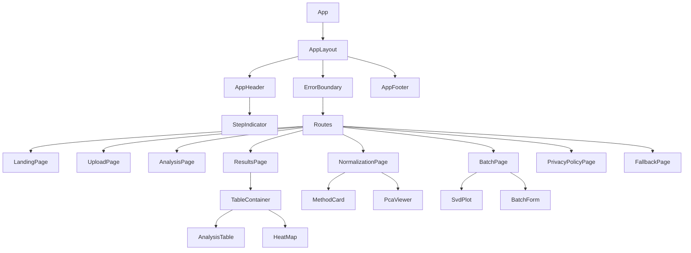

# Frontend Theming and Design System

**Scope:** frontend structure, routing, state, error handling, UI states, export behavior, and styling files under `frontend/app`
**Audience:** Frontend developers, reviewers, and new team members
**Status:** Draft
**Last reviewed:** 2026-07-08

## Purpose

This document describes the frontend design system and structural conventions verified in the current code. It covers more than color tokens: it also records folder placement, routing, component tree, state model, error presentation, loading and empty states, export behavior, Material UI integration, and extension rules.

## Scope

Covered files and directories:

- `frontend/app/src/App.tsx`
- `frontend/app/src/App.css`
- `frontend/app/tailwind.config.ts`
- `frontend/app/src/features/`
- `frontend/app/src/shared/`
- `frontend/app/src/shared/theme/colors.ts`
- `frontend/app/src/shared/components/buttonStyles.ts`
- `frontend/app/src/shared/plots/`

Backend implementation and R scripts are out of scope except where frontend routes or hooks depend on API endpoints. Permanent English documentation should be kept under `docs/`; existing source comments or UI strings are not changed by this document.

## Concepts and Contract

### Feature-Based Folder Structure

The frontend separates business features from shared cross-feature building blocks:

| Area | Verified purpose |
|---|---|
| `frontend/app/src/features/landing/` | Landing page and static landing content. |
| `frontend/app/src/features/upload/` | Upload, staging review, column mapping, and filter setup. |
| `frontend/app/src/features/analysis/` | Filtering progress and filtering statistics. |
| `frontend/app/src/features/normalization/` | Normalization preview, selection, PCA viewer, and normalization submit. |
| `frontend/app/src/features/batch/` | Batch parameters, SVD diagnostics, correction, and skip to analysis. |
| `frontend/app/src/features/results/` | DMP/DMR tables, CSV export, and heatmap generation. |
| `frontend/app/src/shared/` | Components, hooks, layout, plots, theme, errors, pages, utilities, and shared types. |

Placement conventions verified in code:

- Feature pages are named `<Feature>Page.tsx` and live at the feature root.
- Feature-specific components live in `features/<feature>/components/`.
- Feature-specific hooks live in `features/<feature>/hooks/`.
- Feature-specific pure helpers live in `features/<feature>/utils/`.
- Shared reusable components live in `shared/components/`.
- Shared layout components live in `shared/layout/`.
- Shared theme tokens live in `shared/theme/`.
- Shared error handling lives in `shared/errors/`.
- Shared static plot display/export lives in `shared/plots/`.

### Routing Overview

Routes are verified in `frontend/app/src/App.tsx`.

| Route | Page component | Feature or area |
|---|---|---|
| `/` | `LandingPage` | `features/landing` |
| `/upload` | `UploadPage` | `features/upload` |
| `/analysis/:job_id` | `AnalysisPage` | `features/analysis` |
| `/normalization/:job_id` | `NormalizationPage` | `features/normalization` |
| `/batch/:job_id` | `BatchPage` | `features/batch` |
| `/results/:job_id` | `ResultsPage` | `features/results` |
| `/privacy` | `PrivacyPolicyPage` | `shared/pages` |
| `*` | `FallbackPage variant="not-found"` | `shared/components` |

No `/datenschutz` route exists in the current router. The privacy page is implemented at `/privacy`.

### Main Component Tree

Workflow steps are configured in `frontend/app/src/shared/layout/workflowSteps.ts`:

| Step id | Label | Matching prefixes |
|---:|---|---|
| 1 | `Upload` | `/`, `/upload` |
| 2 | `Filter` | `/analysis` |
| 3 | `Normalization` | `/normalization` |
| 4 | `Batch` | `/batch` |
| 5 | `Results` | `/results` |

### State Management

Verified behavior:

- There is no Redux, Zustand, MobX, Context-based global store, or equivalent global frontend store.
- State is local React state in pages/components and custom hooks.
- Long-running backend jobs are tracked by polling through `useJobPolling`.
- Feature hooks own network and workflow state for upload, analysis stats, normalization, batch correction, table data, and heatmap generation.

Polling model:

- `useJobPolling` calls `GET /api/v1/status/{jobId}`.
- Poll interval is `3000` ms.
- Polling stops for failed jobs, normalization waiting, batch waiting, results waiting, and completed heatmap jobs.
- Heatmap generation uses `useHeatMapGeneration`, which delegates status polling to `useJobPolling`.

Pipeline progress semantics should stay aligned with `docs/architecture/pipeline-progress.md`.

### Error Handling

Actual error-handling code lives in `frontend/app/src/shared/errors/`.

| File | Verified purpose |
|---|---|
| `frontend/app/src/shared/errors/ErrorTypes.ts` | `ProblemDetail`, `ApiProblemDetail`, and `ProblemError`. |
| `frontend/app/src/shared/errors/ErrorBoundary.tsx` | Class-based render error boundary wrapped by route-aware `ErrorBoundary`. |
| `frontend/app/src/shared/errors/ErrorMessage.tsx` | Material UI `Snackbar` and `Alert` for user-facing errors. |
| `frontend/app/src/shared/errors/apiError.ts` | Defensive API error message parsing. |

Fallback behavior:

- `ErrorBoundary` resets on route changes and renders `FallbackPage variant="error"` when a render error is caught.
- Unknown routes render `FallbackPage variant="not-found"`.
- Network hooks expose strings or `ProblemDetail` values depending on their local contract.

### UI States

Verified UI state components and patterns:

| State | Implementations |
|---|---|
| Loading | `UploadSpinner`, `LoadingScreen`, `Progressbar`, `SkeletonTable`, `SampleSheetPreviewTable` loading text, Material UI disabled states. |
| Error | `ErrorMessage`, Material UI `Alert`, `FallbackPage variant="error"`, hook-specific inline error panels. |
| Empty | `AnalysisTable` "No data available.", `SvdPlot` "No SVD diagnostics available.", `PcaPlot` "No PCA data.", `FilteringStats` missing-stats warning. |
| Skeleton | `frontend/app/src/features/results/components/table/SkeletonTable.tsx`. |
| Disabled | Shared `Button` disabled styling, Material UI `disabled` props, filter Apply disabled when invalid. |

### Export and Download Behavior

Verified export/download utilities:

| Function or component | Source path | Behavior |
|---|---|---|
| `downloadPlot` | `frontend/app/src/shared/plots/downloadPlot.ts` | Fetches a plot URL as a blob, creates an object URL, clicks a temporary anchor, then revokes the object URL. |
| `exportSvgAsPng` | `frontend/app/src/shared/plots/exportSvg.ts` | Serializes SVG, draws it to canvas, creates PNG blob, and triggers download. |
| `exportSvgAsPdf` | `frontend/app/src/shared/plots/exportSvgAsPdf.ts` | Converts SVG into a PDF export. |
| `exportTableCsv` | `frontend/app/src/features/results/hooks/exportTableCsv.ts` | Fetches CSV export as a blob and downloads `<table>_results_<date>.csv`. |
| `TableExportButton` | `frontend/app/src/features/results/components/table/TableExportButton.tsx` | Styled button that triggers CSV export callback. |
| `PlotExportButtons` | `frontend/app/src/shared/plots/PlotExportButtons.tsx` | Provides PNG and PDF buttons for static `PlotSource` exports. |

No `downloadHeatmap` function exists in the current frontend. Heatmap export is implemented by passing a heatmap `PlotSource` from `useHeatMapGeneration` to `PlotView`, which uses `PlotExportButtons` and `downloadPlot`.

## Reference

### Theme Files

| File | Verified role |
|---|---|
| `frontend/app/src/shared/theme/colors.ts` | Semantic TypeScript color token object. |
| `frontend/app/src/shared/theme/colors.test.ts` | Exact token value tests. |
| `frontend/app/tailwind.config.ts` | Imports `colors` and exposes them through `theme.extend.colors`. |
| `frontend/app/src/App.css` | Tailwind import/config directive plus global base rules. |
| `frontend/app/src/shared/components/buttonStyles.ts` | Canonical button variants and sizes. |
| `frontend/app/src/features/normalization/utils/pcaColors.ts` | Plot-specific categorical PCA palette, separate from the application theme. |

### Semantic Color Tokens

Source: `frontend/app/src/shared/theme/colors.ts`.

Brand tokens:

| Token | Value |
|---|---:|
| `primary.DEFAULT` | `#1A6FA8` |
| `primary.hover` | `#125280` |
| `primary.text` | `#FFFFFF` |
| `secondary.DEFAULT` | `#3D5A80` |
| `secondary.hover` | `#2C3F5C` |
| `secondary.text` | `#FFFFFF` |
| `tertiary.DEFAULT` | `#5C7B8A` |
| `tertiary.hover` | `#435C68` |
| `tertiary.text` | `#FFFFFF` |

State tokens:

| Token group | Default | Hover | Text | Badge background | Badge text |
|---|---:|---:|---:|---:|---:|
| `success` | `#1E7D4E` | `#155C38` | `#FFFFFF` | `#DCFCE7` | `#155C38` |
| `warning` | `#B45309` | `#8A3F07` | `#FFFFFF` | `#FEF3C7` | `#8A3F07` |
| `danger` | `#B91C1C` | `#8B1313` | `#FFFFFF` | `#FEE2E2` | `#8B1313` |
| `error` | Alias of `danger` | Alias of `danger` | Alias of `danger` | Alias of `danger` | Alias of `danger` |
| `info` | `#0E6BAB` | `#094E7E` | `#FFFFFF` | `#DBEAFE` | `#094E7E` |

Neutral tokens:

| Token | Value |
|---|---:|
| `neutral.textPrimary` | `#0F172A` |
| `neutral.textSecondary` | `#475569` |
| `neutral.textDisabled` | `#94A3B8` |
| `neutral.background` | `#F8FAFC` |
| `neutral.surface` | `#F1F5F9` |
| `neutral.card` | `#FFFFFF` |
| `neutral.borderDefault` | `#E2E8F0` |
| `neutral.borderEmphasis` | `#CBD5E1` |

Older names such as `foreground`, `subtle`, and `subtle-foreground` are not present in the current token object and should not be introduced.

### CSS Custom Properties and Tailwind Mapping

The current code does not define hand-written CSS custom properties such as `--primary` in `App.css`. Token mapping is implemented through Tailwind configuration:

1. `colors.ts` exports the semantic token object.
2. `tailwind.config.ts` imports that object and passes it to `theme.extend.colors`.
3. Tailwind classes use token paths, for example `bg-primary`, `text-primary-text`, `border-neutral-borderDefault`, and `bg-success-badgeBackground`.

`App.css` uses Tailwind's `theme(colors.primary.DEFAULT)` function in the global focus-visible rule.

### Interaction States

Verified states:

- Hover: `primary-hover`, `secondary-hover`, `tertiary-hover`, status hover tokens, `hover:bg-neutral-surface`, and `hover:text-primary-hover`.
- Focus: `App.css` defines a global focus-visible outline of `3px solid theme(colors.primary.DEFAULT)` with `outline-offset: 3px`.
- Disabled: shared buttons use `disabled:cursor-not-allowed disabled:opacity-60`; Material UI controls use `disabled` props.
- Destructive: shared `Button` supports `variant="danger"` and `ConfirmDialog` uses it when `destructive` is true.

No separate active-state token group is implemented.

### Typography, Spacing, Radii, and Shadows

Verified styling:

- No custom font family is configured in `tailwind.config.ts`.
- `App.css` sets `font: inherit` for form controls.
- Typography uses Tailwind utilities such as `text-sm`, `text-base`, `text-2xl`, `text-4xl`, `font-semibold`, `font-bold`, and line-height utilities.
- Layout uses Tailwind utilities such as `mx-auto`, `max-w-*`, `px-*`, `py-*`, `grid`, `flex`, `gap-*`, and `space-y-*`.
- Border and radius conventions use `rounded-md`, `rounded-lg`, `rounded-xl`, `border-neutral-borderDefault`, and `border-neutral-borderEmphasis`.
- Shadows are utility-based: `shadow-sm`, `shadow-md`, `shadow-lg`, and `shadow-2xl`.

No separate typography, spacing, radius, or shadow token files exist.

### Button System

`frontend/app/src/shared/components/buttonStyles.ts` defines:

- Variants: `"primary"`, `"secondary"`, `"danger"`.
- Sizes: `"sm"`, `"md"`, `"lg"`, `"icon"`.
- Shared base classes for border, radius, font weight, transition, focus-visible outline, and disabled state.

Use `Button` for standard button elements and `buttonClasses` for non-button elements that need the same styling, such as the landing page CTA `Link`.

### Material UI Integration

Material UI is used for richer interactive controls and feedback:

- Accordions in upload filters and heatmap.
- Selects, autocomplete, text fields, switches, alerts, snackbars, progress bars, tables, skeletons, and icons.
- `sx` props are used for targeted styling, for example `BatchForm` styles the info `Alert` with values from `colors.info`.

No custom MUI theme provider or MUI CSS-variable theme is configured in the current code. MUI and Tailwind coexist at component level; Tailwind handles most layout and semantic token classes, while MUI handles widget behavior.

## Error and Edge Cases

- The codebase contains some hard-coded non-theme colors for plot rendering and a few MUI palette shortcuts such as `grey.50`; these are verified in source and should be treated as existing exceptions.
- `PcaPlot` uses hard-coded SVG colors for export readability.
- `HelpContent` uses Tailwind palette classes such as `zinc` and `indigo`.
- `HeatMap` uses classes such as `text-slate-500` and `text-red-500`.
- `colors.test.ts` verifies token existence and values, but it does not calculate contrast ratios. Therefore this document does not assert conformance to any WCAG level.
- Existing frontend source comments or UI strings may contain mojibake or non-English fragments; this documentation remains English and does not change production code.

## Extension Points

### Adding or Changing a Theme Token

Verified and recommended workflow:

1. Update `frontend/app/src/shared/theme/colors.ts`.
2. Update `frontend/app/src/shared/theme/colors.test.ts`.
3. Confirm `frontend/app/tailwind.config.ts` still imports the token object.
4. Replace component-level hard-coded colors only where the new token semantically applies.
5. Run frontend tests, lint, and build.

### Styling a New Component

Recommendations based on current code:

- Use semantic Tailwind token classes for normal app UI.
- Use `Button` for standard actions.
- Use `Modal` for dialogs.
- Use `PlotView` for static server-rendered plots.
- Keep component-specific CSS out of new files unless Tailwind and existing shared components are insufficient.
- Avoid hard-coded colors for app UI; exceptions should be justified, as with scientific plot palettes.

### Accessibility Considerations

Verified behavior to preserve:

- Keep visible focus states through `App.css` and component-level focus classes.
- Use labelled dialogs through `Modal`.
- Use `aria-current` for current workflow and pagination states.
- Use native controls or MUI controls for keyboard support.
- Do not claim contrast compliance unless a contrast test is added.

### Testing Expectations

Current practice uses co-located Vitest tests. Theme token values are tested in `frontend/app/src/shared/theme/colors.test.ts`; components and hooks are tested beside their source files.

For new visual or structural work, add tests for:

- Token additions or changed token values.
- Component states such as loading, error, empty, disabled, and selected.
- Export actions where the component triggers downloads.
- Accessibility-relevant behavior for dialogs and keyboard-operable controls.

## Cross-links

- [Frontend architecture](../architecture/frontend-architecture.md)
- [Pipeline progress](../architecture/pipeline-progress.md)
- [API contract](../architecture/api-contract.md)
- [Hooks reference](hooks-reference.md)
- [Components reference](components-reference.md)
